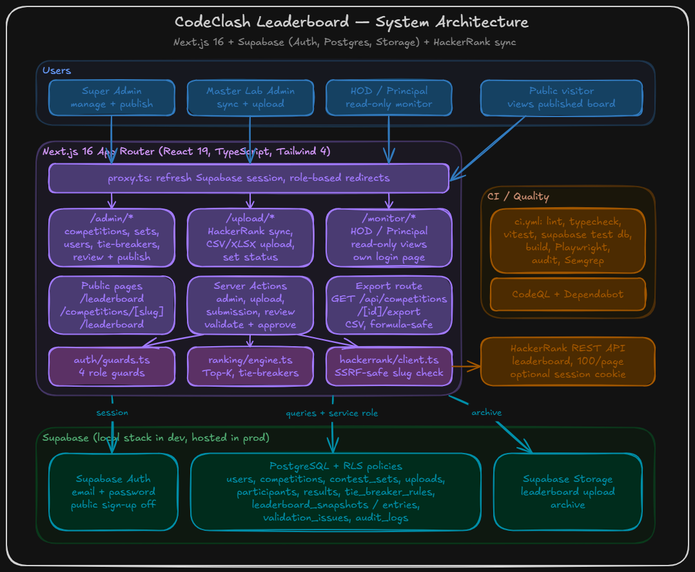

# Code Clash Leaderboard


[](LICENSE)

Code Clash Leaderboard is a centralized platform for managing multi-lab coding competitions, featuring live HackerRank API leaderboard syncing, automated data validation, unified cross-set ranking, and Top K participant selection. Competition administrators set up contests and contest sets, while administrators can fetch live results directly from HackerRank contests or upload spreadsheets to consolidate participants into one shared, real-time leaderboard.

## Screenshots

Visual preview of the administrator sign-in portal and the competition overview dashboard:

| Administrator Sign-in | Competition Dashboard |
| :---: | :---: |
|  |  |

## Competition workflow

| Role | Primary Route | Core Capabilities |
| --- | --- | --- |
| **Super Admin** | `/admin` | Provision competitions, create contest sets, review uploaded submissions, approve/reject uploads, configure tie-breaking rules, trigger unified rankings, and publish leaderboards. |
| **Master Lab Admin** | `/upload` | Access contest sets, ingest results via live HackerRank REST API sync or spreadsheet upload (CSV/Excel), validate participant entries, and submit for Super Admin approval. |
| **HOD / Principal** | `/monitor` | Real-time institutional monitoring dashboard to oversee event progress, participation metrics, and approved leaderboards without editing permissions. |
| **Public / Participants** | `/leaderboard` | View real-time published leaderboards, contest-specific rankings, and Top-K qualifiers with tie-breaking breakdowns. |

The centralized Version 2 architecture uses one **Master Lab Admin** to ingest independent contest-set results, while the **Super Admin** oversees approval, ranking configuration, and publication. Submissions are securely stored in Supabase, participant records are validated, and scores are merged across sets into a unified leaderboard. See the [delivery plan](docs/decisions-and-delivery.md).

## Architecture



The system architecture diagram illustrates the end-to-end flow from user and administrator actions through Next.js server components, authentication, Supabase persistence, and live leaderboard ingestion.

The app uses the Next.js App Router, React, TypeScript, and Tailwind CSS. The request proxy refreshes Supabase sessions, and protected pages load data through the server client. PostgreSQL migrations define the contest tables and row-level security policies. Papa Parse reads CSV files and read-excel-file reads Excel workbooks.

## Local development

### Prerequisites

> [!IMPORTANT]
> **Always use `pnpm`** as the package manager for this project (e.g. `pnpm install`, `pnpm run dev`). Do not use `npm` or `yarn` directly to prevent lockfile and dependency mismatches.

* **Node.js**: v24.x or later
* **pnpm**: v11.10.0 or later (`npm install -g pnpm`)
* **Docker Desktop / Docker Engine**: Must be installed and running. The local Supabase environment (PostgreSQL, Auth, Storage) runs entirely inside Docker containers.
* **Supabase CLI**: Can be run on demand via `npx supabase` (no manual installation required), or installed globally with `pnpm add -g supabase` or `brew install supabase/tap/supabase`.

---

### Step-by-Step Setup

1. **Install project dependencies:**
   Always use `pnpm`:
   ```sh
   pnpm install --frozen-lockfile
   ```

2. **Start the local Supabase stack:**
   Ensure Docker Desktop is open and running, then spin up the local Supabase stack. On initial startup, this automatically downloads the required Docker images and executes all migrations in `supabase/migrations/`:
   ```sh
   npx supabase start
   ```
   To inspect the local endpoints, dashboard URL, anon keys, and service keys at any time:
   ```sh
   npx supabase status
   ```

3. **Configure environment variables:**
   Copy the environment template:
   ```sh
   cp .env.example .env.local
   ```
   Populate `NEXT_PUBLIC_SUPABASE_URL`, `NEXT_PUBLIC_SUPABASE_ANON_KEY`, and `SUPABASE_SERVICE_ROLE_KEY` using the values printed by `npx supabase status`. Also set `COMPETITION_ADMIN_EMAIL` and `COMPETITION_ADMIN_PASSWORD` for the local super admin account.

4. **Seed the administrator account and start the app:**
   Sync the admin credentials with the local Supabase database and run the development server with `pnpm`:
   ```sh
   pnpm admin:sync
   pnpm run dev
   ```

5. **Open the application:**
   Navigate to [http://localhost:3000](http://localhost:3000) and sign in using the administrator credentials configured in `.env.local`.

### Rotate the main admin password

Keep `COMPETITION_ADMIN_EMAIL` set to the existing administrator's email. Change `COMPETITION_ADMIN_PASSWORD` in the git-ignored `.env.local` and run `pnpm admin:sync` from the repository root. The command applies the password to the same Supabase account. You can then sign in with the new password. The email selects the account to manage, so setting an unused email provisions a separate administrator.

### Supabase Auth settings

Competition administrators provision lab accounts. Public sign-up is disabled in the local Supabase configuration. Before deployment, disable public sign-up in the hosted Auth settings and verify the sign-in rate limit for the event. The local limit is 30 sign-in and sign-up requests per five minutes per IP. Labs that share a public IP share that allowance.

## Project structure

```text
src/
├── app/
│   ├── layout.tsx & globals.css       Root layout and theme styling
│   ├── page.tsx                       Landing page and role-based redirect
│   ├── login/                         Unified role-based authentication portal
│   ├── admin/                         Super Admin console
│   │   ├── page.tsx                   Competition dashboard & status overview
│   │   ├── actions.ts                 Server actions for competitions, sets, and approvals
│   │   ├── competitions/              Competition creation, contest set management, and upload reviews
│   │   │   └── [id]/rules/            Configurable tie-breaking rules engine
│   │   └── users/                     Account provisioning (Super Admin, Master Lab Admin, HOD, Principal)
│   ├── upload/                        Master Lab Admin ingestion console
│   │   ├── page.tsx                   Contest set selection overview
│   │   ├── [setId]/                   Spreadsheet upload & live HackerRank sync client
│   │   └── actions.ts                 Server actions for file ingestion and HackerRank fetch
│   ├── leaderboard/                   Public unified competition leaderboard
│   ├── competitions/[slug]/           Competition-specific published leaderboard
│   ├── monitor/                       Read-only institutional monitoring dashboard
│   └── api/competitions/[id]/export/  CSV export endpoint for competition rankings
├── components/                        Shared layout, navigation, and footer components
│   ├── AdminNav.tsx                   Super Admin navigation bar
│   ├── FatFooter.tsx                  Comprehensive platform footer
│   └── ThemeToggle.tsx                Dark / light theme toggle
├── lib/
│   ├── auth/                          Role-based access guards (requireSuperAdmin, requireMasterLabAdmin, etc.)
│   ├── hackerrank/                    HackerRank REST API client, SSRF protection, and entry validation
│   ├── ranking/                       Consolidated ranking engine, Top-K calculation, and tie-breakers
│   └── supabase/                      Browser, server, session, and service-role clients
├── proxy.ts                           Edge-compatible Next.js request proxy / middleware
└── types/database.ts                  TypeScript definitions for database schema and roles

supabase/
├── migrations/                        Versioned PostgreSQL schema and RLS policies
├── tests/                             Database integration & permission tests
└── config.toml                        Local Supabase configuration
```

## Checks and production build

| Command | Purpose |
| --- | --- |
| `pnpm lint` | Run ESLint across the repository. |
| `pnpm typecheck` | Generate Next.js route types and run the TypeScript compiler. |
| `pnpm build` | Create the production build using Webpack. |
| `pnpm start` | Serve the production build after `pnpm build`. |
| `pnpm test:signin` | Start the production build on port 3100 and verify the competition admin sign-in flow in Chromium. |
| `pnpm test:permissions` | Check role and account-status enforcement in admin server actions. |
| `supabase test db` | Exercise upload row-level security against a migrated local Supabase database. |

To run the sign-in test locally, use the local Supabase setup above, run `pnpm build`, and install Chromium with `pnpm exec playwright install chromium`. The test reads the admin credentials from the environment or `.env.local`.

GitHub Actions checks pull requests into `main` and pushes to `main`. CI starts a disposable Supabase stack and seeds a test account on the runner. It runs lint, type checking, the production build, the browser test, a high-severity dependency audit, and a Semgrep source scan.

For the full event workflow and acceptance criteria, see the [documentation index](docs/README.md).

## License

This project is licensed under the [MIT License](LICENSE).
