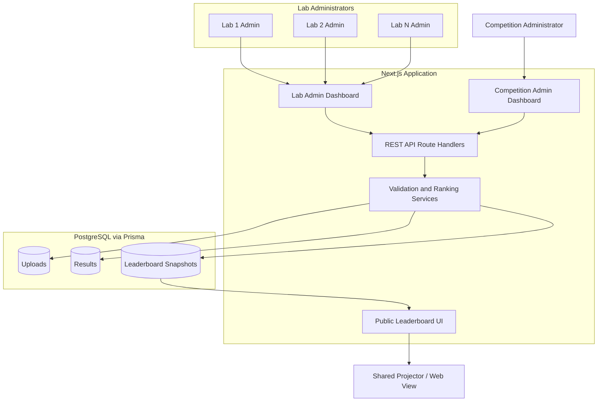

# Code Clash Leaderboard


[](LICENSE)

Next.js starter for the shared Code Clash 2026 leaderboard.

## Architecture



## Requirements

- Node.js 24 LTS (development baseline).
- pnpm 11.10.0, as pinned in `package.json`.

## Development

```sh
pnpm install --frozen-lockfile
pnpm run dev
```

Open [localhost:3000](http://localhost:3000).

## Checks and production

```sh
pnpm lint
pnpm typecheck
pnpm build
pnpm start
```

Run `pnpm build` before `pnpm start`.

## Structure

```text
src/
├── app/               # Page routes & API endpoints (App Router)
│   ├── layout.tsx
│   ├── page.tsx       # / (Landing page)
│   ├── login/         # /login
│   ├── admin/         # /admin (Competition Admin portal)
│   ├── lab-admin/     # /lab-admin (Lab Admin portal)
│   └── api/           # /api/... (REST API endpoints)
├── components/        # Reusable UI (LeaderboardTable, UploadModal, Badges)
├── lib/               # Prisma client, database helpers, auth session
├── services/          # File parser, validation engine, ranking algorithm
└── types/             # Shared TypeScript interfaces and models
```

- `src/app/`: App Router pages, root layout, and global Tailwind styles.
- `src/components/`: Reusable presentation and interactive components.
- `src/lib/`: Database client (Prisma), utility functions, and authentication session helpers.
- `src/services/`: Core business logic (file parser, validation engine, ranking calculations).
- `src/types/`: Shared TypeScript data structures and interfaces.
- `public/`: Static assets.
- `docs/`: Comprehensive requirements, data model, architecture, and operational workflows.
- `pnpm-lock.yaml`: Resolved dependency versions; commit this file.

The starter uses TypeScript, Tailwind CSS and ESLint. It includes a basic project landing page with system fonts, so builds do not need to fetch fonts.

Development and production builds use Next.js's supported Webpack mode with Tailwind's PostCSS plugin because the default Turbopack CSS worker crashed on this Windows environment. Next.js, React and Tailwind use the latest stable releases fetched during setup. ESLint 9 and TypeScript 6 use the newest compatible versions supported by the Next.js lint plugins; Node type definitions match Node.js 24.

The database, organizer authentication, leaderboard features and HackerRank synchronization are planned work. Start with the [documentation index](./docs/README.md).

## License

This project is licensed under the [MIT License](LICENSE).
