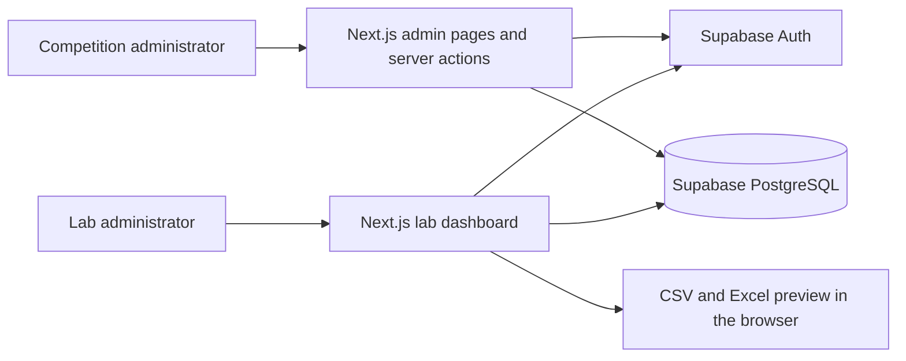

# Code Clash Leaderboard


[](LICENSE)

Code Clash Leaderboard is a web app for running the Code Clash 2026 coding competition across multiple computer labs. Competition administrators set up contests, register labs, and assign lab administrators. The project is being built to let each lab submit its results and combine them into one shared leaderboard that identifies the top qualifiers.

## Competition workflow

| Who | Where | What they can do today |
| --- | --- | --- |
| Competition administrator | `/admin/competitions` and `/admin/users` | Create a contest, provision lab admin accounts, register participating labs, and assign each lab an administrator. |
| Lab administrator | `/lab-admin` | View the assigned lab and deadline, select a CSV or Excel file, map its columns, and inspect the validation report. |
| Visitor | `/` | Sign in to the administrator portal. Public rankings are planned for the publication phase. |

The Phase 2 preview runs in the browser. It reads a UTF-8 CSV or the first worksheet of an `.xlsx` file up to 5 MB. Participant ID, participant name, and total score are required. The table shows the first ten records, while the validation report covers the whole file and identifies rows with missing fields, invalid scores, or duplicate participant IDs.

The remaining Phase 2 work covers submitting the mapped file for review, archiving it privately, and monitoring submissions across labs. Later phases cover approval, cross-lab ranking, publication, and exports. See the [delivery plan](docs/decisions-and-delivery.md).

## Architecture



The app uses the Next.js App Router, React, TypeScript, and Tailwind CSS. The request proxy refreshes Supabase sessions, and protected pages load data through the server client. PostgreSQL migrations define the contest tables and row-level security policies. Papa Parse reads CSV files and read-excel-file reads Excel workbooks.

## Local development

Use Node.js 24, pnpm 11.10.0, the Supabase CLI, and a running Docker engine. Run the following commands from the repository root.

1. Install dependencies and start the local Supabase stack. On first startup, Supabase applies the migrations in `supabase/migrations/`.

   ```sh
   pnpm install --frozen-lockfile
   supabase start
   supabase status
   ```

2. For a fresh checkout, copy `.env.example` to `.env.local`. Set `NEXT_PUBLIC_SUPABASE_URL`, `NEXT_PUBLIC_SUPABASE_ANON_KEY`, and `SUPABASE_SERVICE_ROLE_KEY` using the local API URL, anon key, and service-role key from Supabase. Keep the service-role key server-side.

3. In `.env.local`, set `COMPETITION_ADMIN_EMAIL` and `COMPETITION_ADMIN_PASSWORD` for the main competition administrator. Create the account and start the app.

   ```sh
   pnpm admin:sync
   pnpm dev
   ```

4. Open the [local sign-in page](http://localhost:3000/) and use the credentials you configured. To try the lab workflow, create a competition and a lab admin account, then open the competition to register a lab and assign that account. Sign in as the lab admin to preview a results file.

### Rotate the main admin password

Keep `COMPETITION_ADMIN_EMAIL` set to the existing administrator's email. Change `COMPETITION_ADMIN_PASSWORD` in the git-ignored `.env.local` and run `pnpm admin:sync` from the repository root. The command applies the password to the same Supabase account. You can then sign in with the new password. The email selects the account to manage, so setting an unused email provisions a separate administrator.

## Project structure

```text
src/
├── app/
│   ├── layout.tsx and globals.css   Root layout and shared styles
│   ├── page.tsx                     Administrator sign-in at /
│   ├── login/                       Sign-in form and authentication actions
│   ├── admin/
│   │   ├── page.tsx                 Competition admin dashboard
│   │   ├── actions.ts               Create competitions, lab admins, and labs
│   │   ├── competitions/            Contest list and creation form
│   │   │   └── [id]/                Contest details and lab registration
│   │   └── users/                   Lab admin accounts
│   └── lab-admin/
│       ├── page.tsx                 Assigned lab and submission status
│       ├── LeaderboardPreview.tsx   File selection, mapping, and report UI
│       └── leaderboard-preview.ts   File parsing and row validation
├── components/AdminNav.tsx          Competition admin navigation
├── lib/supabase/                    Browser, server, and session helpers
├── proxy.ts                         Next.js request proxy
└── types/database.ts                Shared database types

supabase/config.toml                 Local Supabase configuration
supabase/migrations/                 Versioned database migrations
schema.sql                           SQL schema reference
scripts/seed-admin.ts                Local development admin setup
docs/                                Requirements, data model, workflows, and roadmap
```

## Checks and production build

| Command | Purpose |
| --- | --- |
| `pnpm lint` | Run ESLint across the repository. |
| `pnpm typecheck` | Generate Next.js route types and run the TypeScript compiler. |
| `pnpm build` | Create the production build using Webpack. |
| `pnpm start` | Serve the production build after `pnpm build`. |
| `pnpm test:signin` | Start the production build on port 3100 and verify the competition admin sign-in flow in Chromium. |

To run the sign-in test locally, use the local Supabase setup above, run `pnpm build`, and install Chromium with `pnpm exec playwright install chromium`. The test reads the admin credentials from the environment or `.env.local`.

GitHub Actions checks pull requests into `main` and pushes to `main`. CI starts a disposable Supabase stack and seeds a test account on the runner. It runs lint, type checking, the production build, the browser test, a high-severity dependency audit, and a Semgrep source scan.

For the full event workflow and acceptance criteria, see the [documentation index](docs/README.md).

## License

This project is licensed under the [MIT License](LICENSE).
