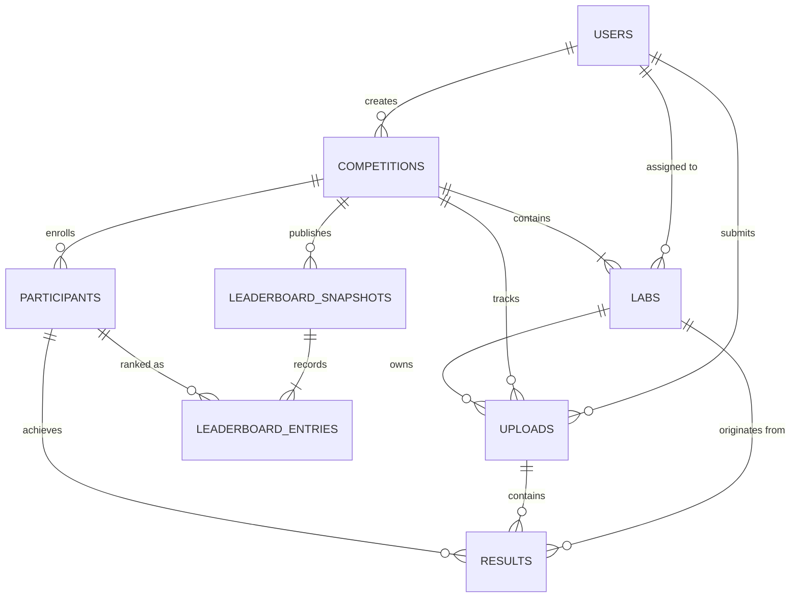

# Relational Data Model

This document outlines the relational database schema, integrity constraints, and snapshot architecture implemented with PostgreSQL and Prisma ORM, matching Section 6 of `Leaderboard_Developer_Doc.docx`.

---

## Entity Relationship Overview



---

## Detailed Table Schemas

### 1. `users`
Stores system administrators and lab proctors with role-based segregation.

| Column | Type | Constraints | Description |
| :--- | :--- | :--- | :--- |
| `user_id` | `UUID` | `PRIMARY KEY`, default `gen_random_uuid()` | Unique user identifier |
| `name` | `VARCHAR(100)` | `NOT NULL` | Full name of administrator |
| `email` | `VARCHAR(255)` | `NOT NULL`, `UNIQUE` | Login email address |
| `password_hash` | `VARCHAR(255)` | `NOT NULL` | Secure salted hash (bcrypt/argon2) |
| `role` | `ENUM` | `NOT NULL` (`COMPETITION_ADMIN`, `LAB_ADMIN`) | Authorization tier |
| `account_status` | `ENUM` | `DEFAULT 'ACTIVE'` (`ACTIVE`, `INACTIVE`) | Account lifecycle state |
| `created_at` | `TIMESTAMPTZ` | `DEFAULT NOW()` | Account creation timestamp |

---

### 2. `competitions`
Represents an independent multi-lab coding competition.

| Column | Type | Constraints | Description |
| :--- | :--- | :--- | :--- |
| `competition_id` | `UUID` | `PRIMARY KEY`, default `gen_random_uuid()` | Unique competition identifier |
| `slug` | `VARCHAR(100)` | `NOT NULL`, `UNIQUE` | URL-friendly slug (e.g. `code-clash-2026`) |
| `competition_name`| `VARCHAR(255)`| `NOT NULL` | Official event title |
| `description` | `TEXT` | `NULLABLE` | Event rules, notes, or descriptions |
| `contest_date` | `DATE` | `NOT NULL` | Date of competition |
| `upload_deadline`| `TIMESTAMPTZ` | `NOT NULL` | Final submission cutoff timestamp |
| `top_k` | `INTEGER` | `NOT NULL`, `DEFAULT 10` | Qualification limit for winners |
| `scoring_config` | `JSONB` | `NOT NULL` | Tie-breaking priority order & criteria |
| `status` | `ENUM` | `DEFAULT 'NOT_STARTED'` | Lifecycle status |
| `visibility` | `ENUM` | `DEFAULT 'PUBLIC'` (`PUBLIC`, `RESTRICTED`) | Access control for public display |
| `created_by` | `UUID` | `FOREIGN KEY (users.user_id)` | Admin who created event |

---

### 3. `labs`
Defines participating computer laboratories attached to a competition.

| Column | Type | Constraints | Description |
| :--- | :--- | :--- | :--- |
| `lab_id` | `UUID` | `PRIMARY KEY`, default `gen_random_uuid()` | Unique lab identifier |
| `competition_id` | `UUID` | `FOREIGN KEY (competitions.competition_id)`, `NOT NULL` | Associated competition |
| `lab_name` | `VARCHAR(100)` | `NOT NULL` | Lab identifier (e.g., `Computer Lab 1`) |
| `assigned_admin_id`| `UUID` | `FOREIGN KEY (users.user_id)`, `NOT NULL` | Assigned Lab Administrator |
| `status` | `ENUM` | `DEFAULT 'ACTIVE'` (`ACTIVE`, `INACTIVE`) | Operational status |

*Constraint:* `UNIQUE (competition_id, lab_name)` and `UNIQUE (competition_id, assigned_admin_id)`.

---

### 4. `uploads`
Tracks raw file uploads, versioning, and administrative review states.

| Column | Type | Constraints | Description |
| :--- | :--- | :--- | :--- |
| `upload_id` | `UUID` | `PRIMARY KEY`, default `gen_random_uuid()` | Unique upload identifier |
| `competition_id` | `UUID` | `FOREIGN KEY (competitions.competition_id)`, `NOT NULL` | Competition reference |
| `lab_id` | `UUID` | `FOREIGN KEY (labs.lab_id)`, `NOT NULL` | Associated lab |
| `uploaded_by` | `UUID` | `FOREIGN KEY (users.user_id)`, `NOT NULL` | Lab Admin who uploaded |
| `file_path` | `VARCHAR(500)` | `NOT NULL` | Secure private disk or cloud storage path |
| `file_name` | `VARCHAR(255)` | `NOT NULL` | Original uploaded file name |
| `upload_version` | `INTEGER` | `NOT NULL`, `DEFAULT 1` | Incremental version number |
| `status` | `ENUM` | `NOT NULL` (`SUBMITTED`, `VALIDATION_FAILED`, `PENDING_APPROVAL`, `APPROVED`, `REJECTED`) | State |
| `record_count` | `INTEGER` | `NOT NULL`, `DEFAULT 0` | Total parsed participant rows |
| `uploaded_at` | `TIMESTAMPTZ` | `DEFAULT NOW()` | Timestamp of upload |
| `approved_by` | `UUID` | `FOREIGN KEY (users.user_id)`, `NULLABLE` | Admin who approved submission |
| `approved_at` | `TIMESTAMPTZ` | `NULLABLE` | Timestamp of approval |
| `rejection_reason`| `TEXT` | `NULLABLE` | Mandatory feedback if rejected |

---

### 5. `participants`
Stores unique participant identities per competition.

| Column | Type | Constraints | Description |
| :--- | :--- | :--- | :--- |
| `participant_id` | `UUID` | `PRIMARY KEY`, default `gen_random_uuid()` | Internal unique identifier |
| `competition_id` | `UUID` | `FOREIGN KEY (competitions.competition_id)`, `NOT NULL` | Associated competition |
| `external_participant_id`| `VARCHAR(100)`| `NOT NULL` | HackerRank username or roll number |
| `participant_name`| `VARCHAR(255)` | `NOT NULL` | Full candidate name |

*Constraint:* `UNIQUE (competition_id, external_participant_id)`.

---

### 6. `results`
Stores participant scores and performance extracted from an approved upload.

| Column | Type | Constraints | Description |
| :--- | :--- | :--- | :--- |
| `result_id` | `UUID` | `PRIMARY KEY`, default `gen_random_uuid()` | Unique result identifier |
| `participant_id` | `UUID` | `FOREIGN KEY (participants.participant_id)`, `NOT NULL` | Participant reference |
| `lab_id` | `UUID` | `FOREIGN KEY (labs.lab_id)`, `NOT NULL` | Source lab |
| `upload_id` | `UUID` | `FOREIGN KEY (uploads.upload_id)`, `NOT NULL` | Ingested upload reference |
| `total_score` | `NUMERIC(8,2)` | `NOT NULL` | Contest total score (supports decimals) |
| `problems_solved`| `INTEGER` | `NOT NULL`, `DEFAULT 0` | Total accepted problems |
| `penalty` | `NUMERIC(10,2)`| `NULLABLE` | Total penalty or contest time in seconds |
| `final_submission_time`| `TIMESTAMPTZ`| `NULLABLE` | Timestamp of last qualifying submission |

---

### 7. `leaderboard_snapshots` & `leaderboard_entries`
Stores versioned, immutable publications of the unified rankings.

#### `leaderboard_snapshots`
| Column | Type | Constraints | Description |
| :--- | :--- | :--- | :--- |
| `leaderboard_id` | `UUID` | `PRIMARY KEY`, default `gen_random_uuid()` | Unique snapshot identifier |
| `competition_id` | `UUID` | `FOREIGN KEY (competitions.competition_id)`, `NOT NULL` | Competition reference |
| `version` | `INTEGER` | `NOT NULL`, `DEFAULT 1` | Incremental publication version |
| `generated_at` | `TIMESTAMPTZ` | `DEFAULT NOW()` | Generation timestamp |
| `published_at` | `TIMESTAMPTZ` | `NULLABLE` | Official publication timestamp |
| `published_by` | `UUID` | `FOREIGN KEY (users.user_id)`, `NULLABLE` | Admin who released snapshot |
| `status` | `ENUM` | `NOT NULL` (`DRAFT`, `PUBLISHED`, `SUPERSEDED`) | Snapshot state |

#### `leaderboard_entries`
| Column | Type | Constraints | Description |
| :--- | :--- | :--- | :--- |
| `entry_id` | `UUID` | `PRIMARY KEY`, default `gen_random_uuid()` | Unique entry identifier |
| `leaderboard_id` | `UUID` | `FOREIGN KEY (leaderboard_snapshots.leaderboard_id)`, `NOT NULL` | Snapshot reference |
| `participant_id` | `UUID` | `FOREIGN KEY (participants.participant_id)`, `NOT NULL` | Participant reference |
| `lab_id` | `UUID` | `FOREIGN KEY (labs.lab_id)`, `NOT NULL` | Participant lab |
| `overall_rank` | `INTEGER` | `NOT NULL` | Calculated rank (with shared rank rules) |
| `total_score` | `NUMERIC(8,2)` | `NOT NULL` | Recorded score at snapshot |
| `problems_solved`| `INTEGER` | `NOT NULL` | Solved count at snapshot |
| `penalty` | `NUMERIC(10,2)`| `NULLABLE` | Penalty duration at snapshot |
| `is_qualified` | `BOOLEAN` | `DEFAULT FALSE` | True if within Top-K threshold |

---

## Column Mapping Schema

When processing uploads, arbitrary header rows are mapped using this JSON structure:

```json
{
  "external_participant_id": "Username",
  "participant_name": "Full Name",
  "total_score": "Score",
  "problems_solved": "Problems Solved",
  "penalty": "Time Taken",
  "final_submission_time": "Last Submission"
}
```

---

## Consistency Rules & Data Integrity

1. **Uniqueness:** A participant can only have one active result per competition. Duplicate participant IDs within a lab or across labs are detected before consolidation.
2. **Snapshot Immutability:** Once a `leaderboard_snapshot` is published, its rows in `leaderboard_entries` are read-only. Updates require creating a new snapshot version (`version = version + 1`).
3. **Decimals & Precision:** Scores are stored as `NUMERIC(8,2)` to preserve partial scores without floating-point rounding errors.
4. **Referential Deletions:** Deleting a competition cascades to labs, uploads, participants, and snapshots. Deleting an active lab is prevented if approved uploads exist.
