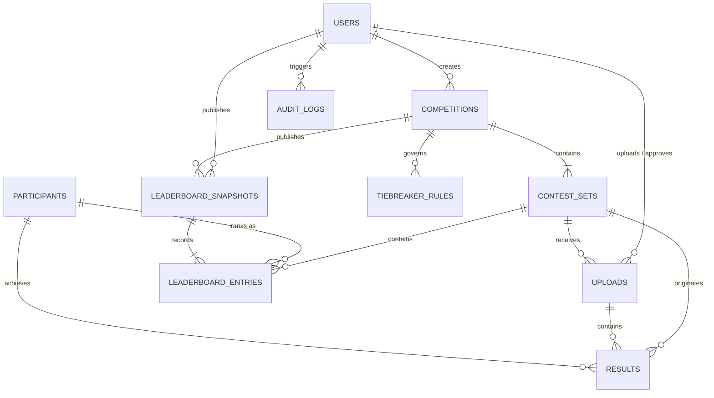

# Relational Data Model

This document describes the production PostgreSQL schema, integrity constraints, and snapshot architecture as implemented in `supabase/migrations/`. The system uses **Supabase** (hosted PostgreSQL with Row-Level Security) as its data layer.

---

## Entity Relationship Overview

The database is organized around **competitions**, **contest sets**, and **rounds**:



---

## Detailed Table Schemas

### 1. `users`
Stores all administrative and institutional monitoring accounts with role-based segregation.

| Column | Type | Constraints | Description |
| :--- | :--- | :--- | :--- |
| `id` | `UUID` | `PRIMARY KEY`, default `gen_random_uuid()` | Unique user identifier |
| `name` | `VARCHAR(100)` | `NOT NULL` | Full name of the user |
| `email` | `VARCHAR(255)` | `NOT NULL`, `UNIQUE` | Unique login email address |
| `password_hash` | `VARCHAR(255)` | `NOT NULL` | Secure salted password hash |
| `role` | `ENUM` | `NOT NULL` (`SUPER_ADMIN`, `MASTER_LAB_ADMIN`, `HOD`, `PRINCIPAL`) | Authorization tier |
| `is_active` | `BOOLEAN` | `DEFAULT TRUE` | Account active toggle |
| `created_at` | `TIMESTAMPTZ` | `DEFAULT NOW()` | Account creation timestamp |

---

### 2. `competitions`
Represents an independent coding competition lifecycle.

| Column | Type | Constraints | Description |
| :--- | :--- | :--- | :--- |
| `id` | `UUID` | `PRIMARY KEY`, default `gen_random_uuid()` | Unique competition identifier |
| `slug` | `VARCHAR(100)` | `NOT NULL`, `UNIQUE` | URL slug (e.g. `code-clash-2026`) |
| `name` | `VARCHAR(255)` | `NOT NULL` | Official event title |
| `description` | `TEXT` | `NULLABLE` | Contest description, rules, and notes |
| `event_date` | `DATE` | `NOT NULL` | Date of competition |
| `top_k` | `INTEGER` | `NOT NULL`, `DEFAULT 10` | Qualification limit for top performers |
| `status` | `ENUM` | `DEFAULT 'NOT_STARTED'` (`NOT_STARTED`, `IN_PROGRESS`, `CONSOLIDATING`, `READY_FOR_REVIEW`, `PUBLISHED`) | Lifecycle state |
| `visibility` | `ENUM` | `DEFAULT 'PUBLIC'` (`PUBLIC`, `RESTRICTED`) | Access control for public display |
| `created_by` | `UUID` | `FOREIGN KEY (users.id)` | Admin who created event |
| `created_at` | `TIMESTAMPTZ` | `DEFAULT NOW()` | Timestamp of creation |

---

### 3. `contest_sets`
Defines independent contest sets per competition. Each set may span **multiple rounds**, with a distinct HackerRank slug per round.

| Column | Type | Constraints | Description |
| :--- | :--- | :--- | :--- |
| `id` | `UUID` | `PRIMARY KEY`, default `gen_random_uuid()` | Unique contest set identifier |
| `competition_id` | `UUID` | `FOREIGN KEY (competitions.id)`, `NOT NULL` | Parent competition reference |
| `set_name` | `VARCHAR(100)` | `NOT NULL` | Human-readable name (e.g., `Set A`) |
| `set_code` | `VARCHAR(50)` | `NOT NULL` | Machine identifier (e.g., `setA`) |
| `round_number` | `INTEGER` | `NOT NULL`, `DEFAULT 1`, `CHECK (round_number > 0)` | Round index within the competition |
| `hackerrank_slug` | `VARCHAR(500)` | `NOT NULL` | HackerRank contest slug or URL for this set's round |
| `auto_sync_status` | `ENUM` | (`PENDING_APPROVAL`, `APPROVED`, `REJECTED`) | Lab auto-sync approval state |
| `is_active` | `BOOLEAN` | `DEFAULT TRUE` | Active operational status |

*Constraints:* `UNIQUE (competition_id, round_number, set_code)` — a set code may be reused across different rounds of the same competition, but not within the same round.

> [!IMPORTANT]
> `round_number` was added in migration `20261128000000_multi_round_support.sql`. Scores are **not** cumulated across rounds; each round produces its own independent leaderboard snapshot.

---

### 4. `uploads`
Tracks raw file uploads per contest set, versioning, and the 3-tier status lifecycle.

| Column | Type | Constraints | Description |
| :--- | :--- | :--- | :--- |
| `id` | `UUID` | `PRIMARY KEY`, default `gen_random_uuid()` | Unique upload identifier |
| `contest_set_id` | `UUID` | `FOREIGN KEY (contest_sets.id)`, `NOT NULL` | Associated contest set |
| `uploaded_by` | `UUID` | `FOREIGN KEY (users.id)`, `NOT NULL` | Master Lab Admin reference |
| `original_filename`| `VARCHAR(255)`| `NOT NULL` | Original client filename |
| `stored_filename` | `VARCHAR(500)` | `NOT NULL` | Secure private storage path |
| `version_number` | `INTEGER` | `NOT NULL`, `DEFAULT 1` | Incremental upload version |
| `upload_status` | `ENUM` | `NOT NULL` (`PENDING`, `UPLOADED`, `FAILED`) | File ingestion status |
| `validation_status`| `ENUM` | `NOT NULL` (`PENDING`, `VALID`, `INVALID`) | Schema and row integrity status |
| `approval_status` | `ENUM` | `NOT NULL` (`PENDING`, `APPROVED`, `REJECTED`) | Administrative review status |
| `uploaded_at` | `TIMESTAMPTZ` | `DEFAULT NOW()` | Upload timestamp |
| `approved_by` | `UUID` | `FOREIGN KEY (users.id)`, `NULLABLE` | Super Admin who approved |
| `approved_at` | `TIMESTAMPTZ` | `NULLABLE` | Approval timestamp |
| `rejection_reason` | `TEXT` | `NULLABLE` | Feedback if rejected |

---

### 5. `participants`
Maintains unique participant identities across the competition.

| Column | Type | Constraints | Description |
| :--- | :--- | :--- | :--- |
| `id` | `UUID` | `PRIMARY KEY`, default `gen_random_uuid()` | System participant identifier |
| `competition_id` | `UUID` | `FOREIGN KEY (competitions.id)`, `NOT NULL` | Parent competition reference |
| `participant_code` | `VARCHAR(100)`| `NOT NULL` | Unique participant ID / platform username |
| `name` | `VARCHAR(255)` | `NOT NULL` | Full participant name |
| `email` | `VARCHAR(255)` | `NULLABLE` | Optional email address |
| `registration_number`| `VARCHAR(100)`| `NULLABLE` | Optional institutional roll number |

*Constraint:* `UNIQUE (competition_id, participant_code)`.

---

### 6. `results`
Stores performance records parsed from approved contest set uploads.

| Column | Type | Constraints | Description |
| :--- | :--- | :--- | :--- |
| `id` | `UUID` | `PRIMARY KEY`, default `gen_random_uuid()` | Unique result identifier |
| `participant_id` | `UUID` | `FOREIGN KEY (participants.id)`, `NOT NULL` | Participant reference |
| `contest_set_id` | `UUID` | `FOREIGN KEY (contest_sets.id)`, `NOT NULL` | Contest set reference |
| `upload_id` | `UUID` | `FOREIGN KEY (uploads.id)`, `NOT NULL` | Source upload reference |
| `score` | `NUMERIC(8,2)` | `NOT NULL` | Total score (supports fractional marks) |
| `problems_solved` | `INTEGER` | `NOT NULL`, `DEFAULT 0` | Total accepted problems |
| `penalty` | `NUMERIC(10,2)`| `NULLABLE` | Penalty duration in seconds |
| `accepted_time` | `TIMESTAMPTZ` | `NULLABLE` | Timestamp of final accepted submission |
| `incorrect_submissions`| `INTEGER` | `NULLABLE`, `DEFAULT 0` | Count of rejected attempts |
| `raw_data` | `JSONB` | `NULLABLE` | Original parsed row payload |
| `created_at` | `TIMESTAMPTZ` | `DEFAULT NOW()` | Record creation timestamp |

---

### 7. `tiebreaker_rules`
Stores the lexicographical tie-breaking criteria configured for a competition.

| Column | Type | Constraints | Description |
| :--- | :--- | :--- | :--- |
| `id` | `UUID` | `PRIMARY KEY`, default `gen_random_uuid()` | Unique rule identifier |
| `competition_id` | `UUID` | `FOREIGN KEY (competitions.id)`, `NOT NULL` | Competition reference |
| `criterion` | `VARCHAR(50)` | `NOT NULL` (`SCORE`, `PROBLEMS_SOLVED`, `PENALTY`, `ACCEPTED_TIME`, `INCORRECT_SUBMISSIONS`) | Ranking attribute |
| `priority` | `INTEGER` | `NOT NULL` | Comparison precedence (1 = highest) |
| `direction` | `ENUM` | `NOT NULL` (`ASCENDING`, `DESCENDING`) | Sorting direction |
| `enabled` | `BOOLEAN` | `DEFAULT TRUE` | Rule toggle |
| `approved_by` | `UUID` | `FOREIGN KEY (users.id)`, `NULLABLE` | Admin who approved configuration |

---

### 8. `leaderboard_snapshots`
Stores versioned, immutable publications of consolidated rankings. Each snapshot is scoped to a **specific round**.

| Column | Type | Constraints | Description |
| :--- | :--- | :--- | :--- |
| `id` | `UUID` | `PRIMARY KEY`, default `gen_random_uuid()` | Unique snapshot identifier |
| `competition_id` | `UUID` | `FOREIGN KEY (competitions.id)`, `NOT NULL` | Competition reference |
| `round_number` | `INTEGER` | `NOT NULL`, `DEFAULT 1`, `CHECK (round_number > 0)` | Round this snapshot belongs to |
| `version_number` | `INTEGER` | `NOT NULL`, `DEFAULT 1` | Incremental version number within the round |
| `generated_by` | `UUID` | `FOREIGN KEY (users.id)`, `NOT NULL` | User who triggered consolidation |
| `approved_by` | `UUID` | `FOREIGN KEY (users.id)`, `NULLABLE` | Super Admin who approved |
| `published_by` | `UUID` | `FOREIGN KEY (users.id)`, `NULLABLE` | Super Admin who published |
| `status` | `ENUM` | `NOT NULL` (`DRAFT`, `APPROVED`, `PUBLISHED`, `SUPERSEDED`) | Snapshot state |
| `generated_at` | `TIMESTAMPTZ` | `DEFAULT NOW()` | Snapshot generation timestamp |
| `published_at` | `TIMESTAMPTZ` | `NULLABLE` | Official publication timestamp |

---

### 9. `leaderboard_entries`
Stores individual ranked contestant rows belonging to an immutable snapshot.

| Column | Type | Constraints | Description |
| :--- | :--- | :--- | :--- |
| `id` | `UUID` | `PRIMARY KEY`, default `gen_random_uuid()` | Unique entry identifier |
| `snapshot_id` | `UUID` | `FOREIGN KEY (leaderboard_snapshots.id)`, `NOT NULL` | Parent snapshot reference |
| `participant_id` | `UUID` | `FOREIGN KEY (participants.id)`, `NOT NULL` | Participant reference |
| `contest_set_id` | `UUID` | `FOREIGN KEY (contest_sets.id)`, `NOT NULL` | Participant's contest set |
| `rank` | `INTEGER` | `NOT NULL` | Calculated rank (with shared ranks) |
| `score` | `NUMERIC(8,2)` | `NOT NULL` | Recorded score at snapshot |
| `qualification_status`| `ENUM` | `NOT NULL` (`QUALIFIED`, `NOT_QUALIFIED`) | Qualification badge state (Top-K) |

---

### 10. `audit_logs`
Provides an immutable ledger of all administrative and lifecycle operations.

| Column | Type | Constraints | Description |
| :--- | :--- | :--- | :--- |
| `id` | `UUID` | `PRIMARY KEY`, default `gen_random_uuid()` | Unique log identifier |
| `user_id` | `UUID` | `FOREIGN KEY (users.id)`, `NULLABLE` | Actor reference |
| `action` | `VARCHAR(100)` | `NOT NULL` | Action performed (e.g. `UPLOAD_SET`, `APPROVE_SET`, `PUBLISH`) |
| `entity_type` | `VARCHAR(50)` | `NOT NULL` | Target entity (e.g. `Upload`, `Competition`) |
| `entity_id` | `UUID` | `NULLABLE` | Affected entity identifier |
| `details` | `JSONB` | `NULLABLE` | Metadata, differences, or rejection comments |
| `timestamp` | `TIMESTAMPTZ` | `DEFAULT NOW()` | Event timestamp |

---

## Views

### `public_leaderboard`
A PostgreSQL view that joins `leaderboard_entries`, `leaderboard_snapshots`, `competitions`, `participants`, and `contest_sets` to expose only `PUBLISHED` snapshots for `PUBLISHED` competitions. Includes `round_number` from `leaderboard_snapshots` for round-aware display. Grants `SELECT` to `anon` and `authenticated`.

---

## Column Mapping Schema

During ingestion, source headers from various platform exports are mapped to standardized internal fields:

```json
{
  "participant_code": "Username",
  "name": "Full Name",
  "score": "Score",
  "problems_solved": "Problems Solved",
  "penalty": "Time Taken",
  "accepted_time": "Last Submission",
  "incorrect_submissions": "Attempts"
}
```

---

## Consistency Rules & Data Integrity

1. **Round Isolation:** Scores are **not** cumulated across rounds. Each round is a self-contained contest. The same set code (e.g., `setA`) may appear in Round 1 and Round 2 with different HackerRank slugs and independent results.
2. **Uniqueness:** `UNIQUE (competition_id, round_number, set_code)` enforces that a set code is unique within a round, not across all rounds.
3. **Participant Uniqueness:** A participant identifier exists once per competition (`UNIQUE (competition_id, participant_code)`). The validation engine flags cross-set collisions within the same round.
4. **Snapshot Immutability:** Once `status = 'PUBLISHED'` on a `leaderboard_snapshot`, its related `leaderboard_entries` are read-only. Corrections require generating an incremented version snapshot (`version_number = 2`).
5. **Decimals & Precision:** Scores use `NUMERIC(8,2)` to guarantee exact fractional mark representations without IEEE 754 floating-point inaccuracies.
6. **Completion Lock:** Consolidation is blocked unless every active contest set for the target round has an approved upload.
7. **Transactional Atomicity:** Consolidation, snapshot creation, and publication execute within atomic SQL transactions.
