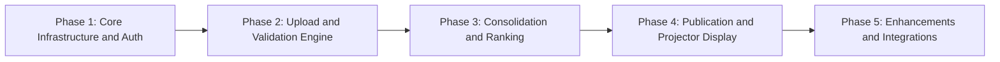

# Decisions and Delivery Plan

This document formalizes the phased implementation roadmap, architectural decisions register, and end-to-end verification test suite matching Sections 12–14 of `Leaderboard_Developer_Doc.docx`.

---

## Phased Implementation Roadmap

### Phase 1: Core Infrastructure & Role-Based Access Control
* **Scope:**
  * Initialize PostgreSQL database and define Prisma ORM schema models (`User`, `Competition`, `Lab`, `Upload`, `Participant`, `Result`, `LeaderboardSnapshot`, `LeaderboardEntry`).
  * Implement session-based authentication with role guards (`COMPETITION_ADMIN`, `LAB_ADMIN`).
  * Build the Competition Administrator dashboard: competition creation, lab registration, and lab administrator account provisioning.
  * Build the base Lab Administrator dashboard with assigned lab profile.
* **Exit Condition:** Competition Admin can create a competition with 4 labs, assign 4 lab admin accounts, and each admin can log in to view their scoped workspace.

---

### Phase 2: Upload Management & Validation Engine
* **Scope:**
  * Multipart file upload handler for `.csv` and `.xlsx` files with magic-byte validation and secure disk archiving.
  * Interactive Column Mapping interface allowing lab admins to map arbitrary export headers to standard internal attributes.
  * Fast file parser (`xlsx` / `papaparse`) and validation engine:
    * Rejection of missing participant IDs/names, non-numeric or negative scores.
    * Detection of internal duplicate participant IDs within the same file.
  * Pre-submission preview table and structured validation issue report.
  * Real-time Upload Status Monitoring Matrix on the Competition Admin dashboard.
* **Exit Condition:** Lab Admin can upload a sample contest file, map columns, preview parsed records, inspect validation flags, and submit for review.

---

### Phase 3: Centralized Consolidation & Ranking Engine
* **Scope:**
  * Competition Admin review interface: view submitted file details, validation summaries, and trigger **Approve** or **Reject** (with feedback).
  * Centralized consolidation service merging approved records across all participating labs.
  * Cross-lab participant collision detector (flagging same ID in multiple labs).
  * Configurable ranking algorithm:
    * Primary: Descending `total_score`.
    * Secondary: Descending `problems_solved`.
    * Tertiary: Ascending `penalty` / contest duration.
  * Shared rank assignment logic (e.g., ties at rank 3 skip to rank 5).
  * Automated Top-K boundary selector and tie-resolution handler.
* **Exit Condition:** Given approved uploads from 4 labs totaling 120 participants, the system consolidates them into a single ranked dataset, correctly assigns ranks and tie-breaks, and selects the Top-K.

---

### Phase 4: Publication, Projector View & Exports
* **Scope:**
  * Publication approval gate: draft snapshot generated in `Ready for Review` status.
  * One-click **Publish Leaderboard** generating immutable versioned snapshot (`v1.0`).
  * Public / Projector Leaderboard (`/competitions/[id]/leaderboard`):
    * High-contrast, responsive layout optimized for auditoriums.
    * Search by participant name/ID, lab filter, and Top-K filter toggle.
    * Visual qualification cards/badges for Top-K ranks.
  * Export engine: Download published results as CSV, Excel (`.xlsx`), or formatted print PDF.
  * Versioned republishing workflow (`v2.0`) in case of post-publication adjustments.
* **Exit Condition:** Shared leaderboard is live, displays identical rankings to all lab monitors simultaneously, and exports clean CSV/Excel files.

---

### Phase 5: Optional Enhancements
* Direct automated HackerRank Community leaderboard polling worker.
* Automated email / system alerts for deadline reminders and submission approvals.
* Historical multi-competition comparative analytics.

---

## Decisions Register

| Decision Area | Status | Agreed Policy |
| :--- | :--- | :--- |
| **Primary Ingestion Method** | **Confirmed** | Independent `.csv` / `.xlsx` file upload by Lab Admins with dynamic column mapping. |
| **Number of Labs** | **Confirmed** | Dynamic. Configured per competition by the Competition Administrator. |
| **Upload Timing** | **Confirmed** | Independent uploads; labs can submit asynchronously before the deadline. |
| **Finalization Gate** | **Confirmed** | All participating labs must be submitted, validated, and explicitly approved before publishing. |
| **Leaderboard Scope** | **Confirmed** | One single, unified leaderboard combining all eligible participants across all labs. |
| **Top-K Value** | **Configurable** | Defined at competition creation (default $K = 10$). |
| **Shared Ranks** | **Confirmed** | Identical results share rank (e.g. 1, 2, 2, 4) rather than arbitrary alphabetical ordering. |
| **Tie at Top-K Cutoff** | **Configurable** | Pre-configured policy: admit all tied participants or apply secondary criteria. |
| **Re-upload Policy** | **Confirmed** | Allowed before final approval; creates new version and archives previous attempts. |
| **Snapshot Immutability** | **Confirmed** | Published snapshots are immutable; corrections produce incremented versions (`v2.0`). |
| **Tech Stack Alignment** | **Confirmed** | Next.js 16 + React 19 + TypeScript + Tailwind CSS + Prisma + PostgreSQL. |

---

## Verification Test Matrix & Acceptance Criteria

Every release milestone must pass this test plan before deployment:

| Test ID | Test Scenario | Expected Result |
| :--- | :--- | :--- |
| **TC-01** | Create competition with 4 labs | 4 lab slots created and linked to competition. |
| **TC-02** | Assign 4 distinct lab administrators | Each admin can log in and view only their assigned lab. |
| **TC-03** | Unauthorized lab admin access | Lab Admin 1 cannot view or modify Lab 2's uploads. |
| **TC-04** | Upload invalid file (missing scores/IDs) | System identifies invalid rows with line numbers and blocks submission. |
| **TC-05** | Upload duplicate participant IDs in lab | Validation engine flags duplicate records for correction. |
| **TC-06** | Lab Admin submits valid file | Status changes to `Pending Approval`; appears in admin monitoring matrix. |
| **TC-07** | Admin rejects lab submission | Rejection note sent to lab admin; status resets to `Awaiting Upload`. |
| **TC-08** | All 4 labs upload valid files | Competition Admin can approve all 4 submissions. |
| **TC-09** | Consolidation of 120 records (4 labs) | Consolidates into exactly 120 unique records with correct tie-breaking. |
| **TC-10** | Set Top-K = 10 | Ranks 1–10 receive qualification status indicator. |
| **TC-11** | Publish leaderboard | Shared URL becomes active; all 4 lab screens see identical rankings. |
| **TC-12** | Export published leaderboard | Downloaded CSV/Excel matches onscreen rankings and scores precisely. |
| **TC-13** | Republish correction | Generates version `v2.0`; version `v1.0` remains intact in audit history. |
