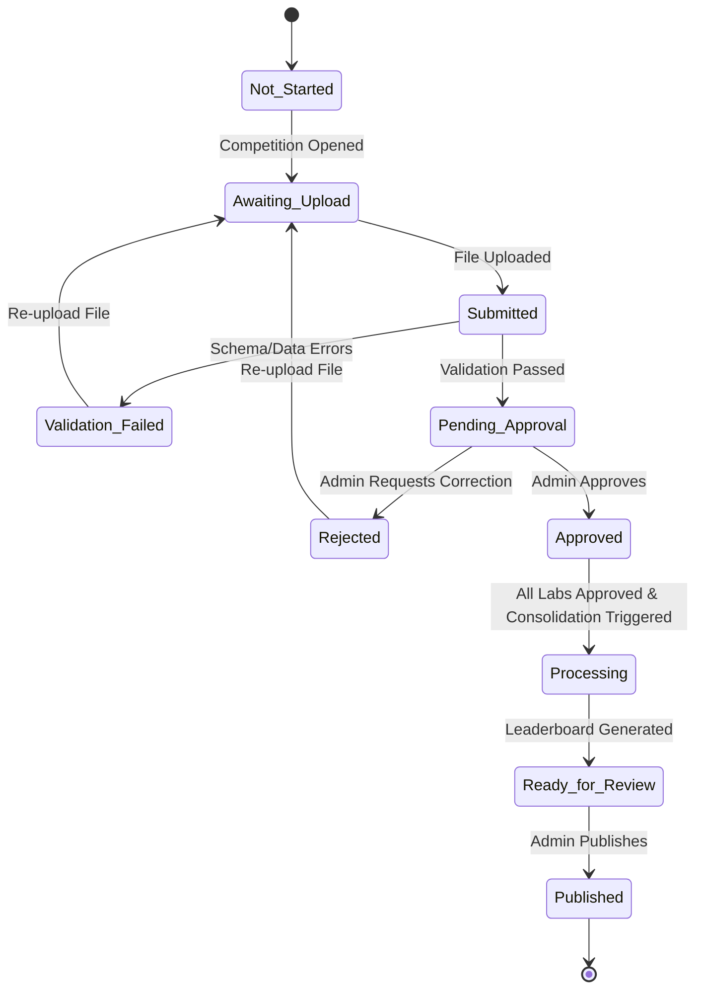

# Functional Requirements

The system requirements are organized into nine core modules, an explicit status lifecycle model, security constraints, and edge-case handling rules based on `Leaderboard_Developer_Doc.docx`.

---

## 1. Core Functional Modules

### Module 1: Authentication & Role-Based Access Control
* **Authentication Mechanism:** Secure session-based or token-based authentication using email/username and password.
* **Password Security:** Mandatory password hashing (e.g. bcrypt/argon2). No plain-text passwords stored.
* **Role Hierarchy:**
  * `COMPETITION_ADMIN`: Global control over competitions, labs, upload approvals, consolidation, and publication.
  * `LAB_ADMIN`: Access strictly scoped to their assigned lab and competition.
* **Account Provisioning:** Lab administrator accounts must be created or assigned by the Competition Administrator. Unrestricted self-registration is disabled to prevent unauthorized data injection.
* **Session Management:** Robust server-side session validation and secure logout functionality.

### Module 2: Competition Management
The Competition Administrator must be able to configure and manage multiple competitions independently:
* **Competition Parameters:**
  * `competition_name`: Official title of the competition.
  * `competition_id`: Unique system-generated slug or identifier.
  * `description`: Contest summary and notes.
  * `contest_date`: Scheduled date of the event.
  * `number_of_labs`: Configured dynamically (no hardcoded limits).
  * `upload_deadline`: Timestamp after which submissions lock.
  * `top_k`: Number of top performers to qualify (e.g., Top 5, 10, 15, 20).
  * `scoring_config`: Configurable scoring criteria and tie-breaking order.
  * `visibility`: `PUBLIC` (open via URL) or `RESTRICTED` (requires login).
* **Multi-Competition Isolation:** Each competition maintains its own distinct labs, uploads, participants, and leaderboard snapshots.

### Module 3: Lab Management
* **Dynamic Lab Setup:** The administrator can add, edit, or deactivate participating labs per competition (e.g., `Lab 1`, `Lab 2`, `Lab 3`, `Lab 4`).
* **Admin Assignment:** Exactly one designated Lab Administrator is mapped to each active lab.
* **Entity Association:** Each lab is tied to its parent competition, assigned admin, raw upload records, and audit history.

### Module 4: Lab Leaderboard Upload & Ingestion
* **Dedicated Lab Portal:** Each Lab Administrator has a dedicated upload screen displaying assigned competition details and upload instructions.
* **File Format Support:** Accepts `.csv` and `.xlsx` files. The raw file is archived securely for audit purposes.
* **Dynamic Column Mapping:** Ingestion cannot depend on fixed header naming (e.g. different HackerRank exports may label columns as `Username`, `Name`, `Candidate`, `Score`, or `Total`).
  * The UI provides a visual column mapper to map raw headers to standard internal attributes:
    * `participant_id` (Required)
    * `participant_name` (Required)
    * `total_score` (Required)
    * `problems_solved` (Recommended)
    * `penalty` or `contest_time` (Conditional / Tie-breaker)
    * `submission_count` (Optional)
  * Preset mapping templates (e.g., "Default HackerRank CSV Export") are available for quick configuration.
* **Upload Confirmation:** Displays a parsed data preview and validation summary before the administrator confirms submission.

### Module 5: Data Validation & Error Handling
Every uploaded file undergoes automated validation prior to admin review:

| Validation Rule | Enforcement Behavior |
| :--- | :--- |
| **Missing Participant ID / Name** | Reject affected record; display row number in report. |
| **Invalid or Non-numeric Score** | Reject affected record. |
| **Negative Score** | Reject record unless negative marks are explicitly permitted in scoring config. |
| **Internal Lab Duplicate** | Flag duplicate participant ID within the same lab for review. |
| **Cross-Lab Duplicate** | Detect and flag identical participant IDs appearing across different labs. Block consolidation until reviewed. |
| **Empty or Malformed File** | Reject entire upload immediately with a descriptive error. |
| **Unsupported File Type** | Validate magic MIME bytes; reject unsupported extensions. |
| **Unmapped Required Column** | Prevent submission until all required fields are mapped. |

* **Validation Report:** Generates an accessible report detailing: Total Records Detected, Valid Records, Invalid Records, Duplicate Records, and an itemized issue list with row numbers.

### Module 6: Centralized Upload Monitoring Dashboard
The Competition Administrator monitors submission progress across all participating labs from a real-time matrix:
* Metrics: Total Labs, Labs Pending Upload, Submissions Awaiting Approval, Approved Submissions, Rejected Submissions, and Total Participants Ingested.
* Direct drill-down: Administrator can inspect any lab’s uploaded file, column mapping, and validation report.
* Approval Action: Administrator can mark an upload as **Approved** or **Rejected** (with mandatory feedback comments for corrections).

### Module 7: Unified Leaderboard Consolidation & Ranking Engine
Once all required labs have approved uploads, the system initiates consolidation:
1. Gathers approved participant records across all labs into a single dataset.
2. Performs a final cross-lab uniqueness and eligibility verification.
3. Applies global ranking criteria (configurable order):
   * Primary: Descending `total_score`.
   * Secondary: Descending `problems_solved`.
   * Tertiary: Ascending `penalty` / total duration.
   * Quaternary: Earlier `final_submission_time`.
4. Supports **shared ranks** (e.g., tied at Rank 3 results in both participants receiving Rank 3, with the subsequent rank skipping to Rank 5) rather than arbitrary alphabetical ordering.
5. Produces a common ranking without reserving artificial quotas for individual labs.

### Module 8: Top-K Participant Selection
* Automatically identifies the first $K$ eligible participants based on the configured competition threshold.
* Visually distinguishes qualified contestants with a highlighted badge/card.
* **Boundary Tie Policy:** If multiple participants tie at rank $K$ (e.g., 3 participants tied at Rank 10), the system applies the pre-configured boundary policy (either admit all tied contestants or apply a secondary tie-break rule).

### Module 9: Leaderboard Publication & Shared Display
* **Publication Gate:** The unified leaderboard remains in `Ready for Review` status until the Competition Administrator explicitly clicks **Publish**.
* **Public Projector / Web View:**
  * Clean, responsive layout optimized for large auditorium projectors and lab screens.
  * Displays: Rank, Participant Name, Participant ID, Lab Name, Score, Problems Solved, Penalty, and Qualification Status.
  * Interactive features: Search participants, filter by lab, filter to Top-K only, sort columns.
  * Export capabilities: One-click export to CSV, Excel (`.xlsx`), and print-friendly PDF.
* **Immutability & Versioning:** Publishing generates a new immutable snapshot version (e.g., `v1.0`). Any post-publication corrections generate a `v2.0` draft requiring explicit re-approval.

---

## 2. System State & Status Lifecycle

The system enforces a strict finite state machine across competitions and individual lab uploads:

| Status | Definition |
| :--- | :--- |
| **Not Started** | Competition created but upload window is not yet active. |
| **Awaiting Upload** | Lab has not submitted its contest leaderboard. |
| **Submitted** | File uploaded; undergoing automated validation. |
| **Validation Failed** | File contains unmapped columns, corrupt data, or invalid types. |
| **Pending Approval** | File parsed successfully; waiting for Competition Admin inspection. |
| **Approved** | Submission verified and locked for consolidation. |
| **Rejected** | Admin returned submission to lab admin with corrective feedback. |
| **Processing** | Backend engine is aggregating, deduplicating, and ranking records. |
| **Ready for Review** | Consolidated leaderboard generated but held as draft. |
| **Published** | Official leaderboard live and accessible on shared URLs. |

---

## 3. Security & Reliability Requirements

1. **Role-Based Server Enforcement:** All `/api/admin/*` and `/api/labs/*` endpoints check user permissions on the server. Frontend UI button concealment is never treated as security.
2. **File Upload Security:** Files are validated by content magic bytes, size-capped (e.g., max 10MB), and isolated in private storage.
3. **Deterministic Ranking:** Re-running the ranking engine with identical approved inputs produces identical ranks.
4. **Audit Logging:** Every critical action (upload, rejection, approval, consolidation, publish, unpublish) logs actor ID, timestamp, and metadata.
5. **Transactional Consistency:** Database updates during consolidation and publishing execute within atomic database transactions.

---

## 4. Edge Cases & Resilience Rules

| Scenario | System Handling |
| :--- | :--- |
| **One Lab Fails to Upload by Deadline** | Final consolidation and publication remain locked. Administrator can grant an extension or explicitly exclude the lab. |
| **Empty or Corrupted File Uploaded** | Rejected immediately with descriptive validation feedback. |
| **Participant Present in Multiple Labs** | System detects cross-lab collision, alerts Competition Admin, and blocks automatic publication until resolved. |
| **Multiple Submissions from One Lab** | Re-uploading creates a new version; only the approved version contributes to the final ranking. |
| **Zero-Score Participants** | Handled per competition policy (included at bottom of ranking or flagged as non-qualifying). |
| **Tie at Top-K Boundary** | Enforces the pre-configured boundary policy (e.g., include all tied contestants or invoke tie-breaker rule). |
| **Post-Publication Score Correction** | Generates a new snapshot version (`v2.0`). Previous version is retained in audit history. |
