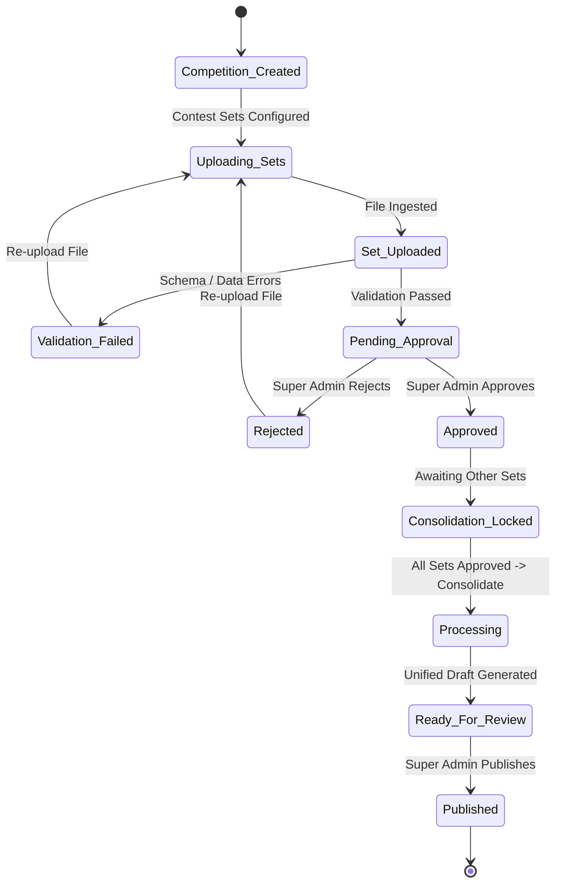

# Functional Requirements

The system requirements are organized into ten functional modules, an updated role permission matrix, a finite state lifecycle model, security constraints, and edge-case handling rules based on `Revised_LeaderBoardManagement(CodeClash).docx` (Version 2.0).

---

## 1. Core Functional Modules

### Module 1: Authentication & Role-Based Access Control
* **Authentication Mechanism:** Secure session-based or token-based authentication using email/username and password.
* **Password Security:** Mandatory salted password hashing (e.g., bcrypt/argon2). No plain-text passwords stored.
* **Role Hierarchy:**
  * `SUPER_ADMIN` (or `COMPETITION_ADMIN`): Full authority over competitions, contest sets, user accounts, upload approvals, tie-breaker configurations, and final publication.
  * `MASTER_LAB_ADMIN`: Operational manager who uploads contest-set files, inspects validation reports, manages re-uploads, proposes tie-breakers, and triggers consolidation.
  * `HOD` (Head of Department): Institutional observer with dedicated read-only dashboard to monitor uploads, inspect set-wise rankings, unified standings, Top-K rosters, and audit publication status.
  * `PRINCIPAL`: Institutional executive observer with dedicated read-only dashboard to monitor campus-wide participation metrics, set-wise and unified standings, and ranking methodology.
* **Account Provisioning:** Accounts for Master Lab Admin, HOD, and Principal are created and assigned directly by the Super Admin. Unrestricted public self-registration is disabled.
* **Server-Side Authorization:** All read-only constraints on HOD and Principal dashboards must be enforced on the backend. Frontend UI concealment alone is strictly insufficient.

---

### Module 2: Competition Management
The Super Admin configures and manages competitions independently:
* **Competition Parameters:**
  * `name`: Official title of the competition (e.g., `Code Clash 2026`).
  * `description`: Contest summary, instructions, and rules.
  * `event_date`: Scheduled date of the event.
  * `number_of_sets`: Configured dynamically (not hardcoded to 4).
  * `top_k`: Number of top performers to qualify (e.g., Top 5, 10, 15, 20).
  * `upload_format_config`: Specification of accepted columns and file formats.
  * `ranking_config`: Configurable lexicographical ranking and tie-breaker parameters.
  * `visibility`: `PUBLIC` (open via `/leaderboard`) or `RESTRICTED` (requires authenticated session).
* **Multi-Competition Isolation:** Each competition maintains its own distinct contest sets, uploads, participants, audit logs, and versioned leaderboard snapshots.

---

### Module 3: Contest Set Management
Replaces the deprecated physical lab management module:
* **Dynamic Set Setup:** The Super Admin defines contest sets per competition (e.g., `Set A`, `Set B`, `Set C`, `Set D`).
* **Set Attributes:**
  * `set_name`: Human-readable name (e.g., `Set A`).
  * `set_code`: Unique identifier (e.g., `SET_A`).
  * `contest_url`: Platform URL for that set (e.g., `/setA`).
  * `is_active`: Operational toggle for the contest set.
* **Independent Upload Slots:** Each configured contest set creates an independent ingestion slot on the centralized upload dashboard.

---

### Module 4: Centralized Contest Set Upload & Ingestion
* **Centralized Console:** The Master Lab Admin accesses a single unified dashboard listing upload slots for all configured contest sets.
* **Asynchronous Uploads:** Files for contest sets can be uploaded in **any order** (e.g., Set C can be uploaded before Set A).
* **File Format Support:** Ingestion supports `.csv` and `.xlsx` files. The raw file is securely archived outside the public web root for audit compliance.
* **Dynamic Column Mapping:** Handles variable header labels across platform exports via a visual mapper:
  * `participant_id` (Mandatory unique identifier / username)
  * `participant_name` (Mandatory participant name)
  * `total_score` (Mandatory score, numeric)
  * `problems_solved` (Optional / Secondary tie-breaker)
  * `penalty` (Optional / Ascending tie-breaker)
  * `accepted_time` (Optional final accepted submission timestamp)
  * `incorrect_submissions` (Optional attempt count)
* **Versioning & Re-upload:** Uploading a revised file creates a new version record (`version_number = version_number + 1`). Previous versions and approval states are invalidated upon re-upload.

---

### Module 5: Automated File Validation & Error Reporting
Every uploaded file triggers immediate server-side validation:

| Validation Rule | Enforcement Behavior |
| :--- | :--- |
| **Missing Participant ID / Name** | Reject record; flag specific row number. |
| **Invalid or Non-Numeric Score** | Reject record; score must be numeric within allowed range (e.g., 0 to 100). |
| **Negative Score** | Reject record unless negative marking is explicitly configured. |
| **Internal Set Duplicate** | Detect and flag duplicate participant IDs within the same file. |
| **Cross-Set Duplicate** | Detect and flag identical participant IDs appearing in multiple contest-set files. |
| **Contest Set Mismatch** | Verify that file metadata matches the assigned contest set slot. |
| **Empty or Malformed File** | Reject entire upload immediately with a descriptive error. |
| **Unsupported File Type** | Verify file MIME type and magic bytes; reject unsupported extensions. |
| **Unmapped Required Column** | Prevent ingestion confirmation until all required columns are mapped. |

* **Validation Report:** Automatically generated for each upload:
  * Total Records Ingested
  * Valid Records Count
  * Invalid Records Count
  * Duplicate Records Identified
  * Itemized Row-by-Row Error Log

---

### Module 6: Centralized Upload Review & Approval Gate
The system enforces a 3-tier status model for every contest set upload:
1. `upload_status`: `PENDING` | `UPLOADED` | `FAILED`
2. `validation_status`: `PENDING` | `VALID` | `INVALID`
3. `approval_status`: `PENDING` | `APPROVED` | `REJECTED`

* **Review Authority:** The Super Admin inspects the validation report, previews parsed rows, and executes **Approve** or **Reject** (with mandatory feedback).
* **Consolidation Gate (Completion Check):** The system verifies that **all** configured contest sets have:
  1. An uploaded file.
  2. Successful (`VALID`) validation status.
  3. Super Admin (`APPROVED`) approval status.
* If any contest set is pending, invalid, or rejected, the consolidation trigger remains strictly locked.

---

### Module 7: Unified Leaderboard Consolidation & Configurable Ranking Engine
Once all required contest sets are approved, consolidation merges all set records into a unified competition dataset:
* **Lexicographical Comparison Algorithm:** Evaluates participants sequentially against enabled criteria in priority order:
  1. Primary: `Total Score` (Higher first / Descending).
  2. Secondary: `Problems Solved` (Higher first / Descending).
  3. Tertiary: `Total Penalty` (Lower first / Ascending).
  4. Quaternary: `Final Accepted Submission Time` (Earlier first / Ascending).
  5. Quinary: `Incorrect Submissions` (Lower first / Ascending).
  6. Senary: `Number of Attempts` (Lower first / Ascending).
* **Dynamic Configuration:** Administrators can enable/disable criteria, reorder priorities, and adjust sorting directions. The Master Lab Admin may propose configurations; the Super Admin holds final approval authority.
* **Shared Ranks:** If participants remain equal across all enabled criteria, the system assigns shared ranks (e.g., tied at Rank 1 results in Rank 1 for both, with the next participant ranked as Rank 3). Arbitrary alphabetical tie-breaking is prohibited.
* **No Artificial Set Quotas:** Overall rankings are purely merit-based across all contest sets. The system does not force an equal distribution of participants per set.
* **Fairness Requirement (Contest-Set Equivalence):** Organizers must verify that contest sets are equivalent in difficulty, marks, duration, and penalty rules before raw scores are directly ranked.

---

### Module 8: Top-K Participant Selection & Boundary Policy
* Automatically identifies the top $K$ participants based on the configured competition threshold.
* Visually highlights qualified contestants with distinct podium cards and qualification badges.
* **Boundary Tie Policy:** If multiple participants tie exactly at rank $K$ (e.g., three contestants tied at Rank 10):
  * The system highlights the boundary tie condition.
  * The Super Admin applies the pre-approved institutional policy (e.g., admit all tied participants or apply secondary tie-break rules).
  * The system records the decision and justification in the audit log; contestants are never silently eliminated.

---

### Module 9: Leaderboard Publication & Version Management
* **Publication Gate:** Consolidated standings remain in `Ready for Review` (draft) status until the Super Admin explicitly clicks **Publish**.
* **Public / Projector Display (`/leaderboard`):**
  * Clean, responsive, high-contrast interface designed for auditoriums, lab screens, and contestant devices.
  * Displays: Rank, Participant Name, Participant ID, Contest Set, Score, Problems Solved, Penalty, and Qualification Status.
  * Real-time search, contest-set filtering, and Top-K filter toggles.
  * One-click exports to CSV, Excel (`.xlsx`), and print-friendly PDF.
* **Immutable Snapshot Versioning:** Publication saves an immutable snapshot (`v1.0`). Any post-publication corrections generate a draft `v2.0` snapshot requiring re-validation, re-approval, and formal republishing.

---

### Module 10: Principal & HOD Monitoring Module
Dedicated institutional monitoring module added in Version 2.0:
* **Dashboard Overview:** Displays live institutional metrics:
  * Total participants ingested.
  * Total contest sets and set breakdown.
  * Upload completion status ($N/N$ sets uploaded).
  * Approval completion status ($N/N$ sets approved).
  * Top-K qualification threshold.
  * Leaderboard generation and publication status.
* **Set-Wise Leaderboard Switcher:** Tabs allow the Principal and HOD to switch between Set A, Set B, Set C, Set D, and inspect set-specific standings.
* **Unified Leaderboard View:** Real-time inspection of the overall consolidated leaderboard and Top-K roster.
* **Ranking Transparency:** Explicitly displays the configured ranking and tie-breaking criteria in priority order.
* **Strict Read-Only Restrictions:**
  * Cannot upload or delete files.
  * Cannot edit participant records or score values.
  * Cannot modify ranking rules or tie-breakers.
  * Cannot approve, reject, or publish results.
  * Read-only permissions enforced on the backend API.

---

## 2. Revised Role Permission Matrix

| Functionality | Super Admin | Master Lab Admin | HOD | Principal |
| :--- | :---: | :---: | :---: | :---: |
| **Create Competition** | Yes | No | No | No |
| **Manage Contest Sets** | Yes | No | No | No |
| **Manage Users & Roles** | Yes | No | No | No |
| **Upload Leaderboard Files** | Yes | Yes | No | No |
| **View Uploaded Files** | Yes | Yes | View Only | View Only |
| **Validate Uploaded Files** | Yes | Yes | View Status | View Status |
| **Approve / Reject Uploads** | Yes | No | No | No |
| **Configure Tie-Breakers** | Approve / Modify | Propose / Configure | View Only | View Only |
| **Generate Unified Leaderboard**| Yes | Yes | No | No |
| **Approve Final Leaderboard** | Yes | No | No | No |
| **Publish Leaderboard** | Yes | No | No | No |
| **View Set-Wise Rankings** | Yes | Yes | Yes | Yes |
| **View Unified Leaderboard** | Yes | Yes | Yes | Yes |
| **View Top-K Qualified** | Yes | Yes | Yes | Yes |
| **Export Reports** | Yes | Yes | Optional / View | Optional / View |
| **View Audit Logs** | Yes | Yes | No | No |

---

## 3. System State & Status Lifecycle

The system enforces a finite state machine across contest-set uploads and the competition lifecycle:

### Upload Lifecycle States

| Status | Meaning |
| :--- | :--- |
| **Awaiting Upload** | No file has been submitted for this contest set. |
| **Submitted / Parsing**| File received; server-side parsing and column mapping in progress. |
| **Validation Failed** | Ingestion rejected due to schema errors, malformed rows, or invalid types. |
| **Pending Approval** | File passed validation; waiting for Super Admin review. |
| **Approved** | Submission locked and marked valid for consolidation. |
| **Rejected** | Super Admin returned submission with corrective notes for re-upload. |

### Competition Lifecycle States

| Status | Meaning |
| :--- | :--- |
| **Not Started** | Competition created; contest sets configured; upload window pending. |
| **In Progress** | Master Lab Admin actively uploading set files. |
| **Consolidating** | All sets approved; ranking engine merging and ranking records. |
| **Ready for Review** | Consolidated leaderboard generated; held as draft for Super Admin approval. |
| **Published** | Official immutable leaderboard live on `/leaderboard` and projector displays. |

---

## 4. Security & Reliability Requirements

1. **Backend Role Enforcement:** API endpoints (`/api/admin/*`, `/api/monitoring/*`, `/api/sets/*`) enforce permissions on the server using verified session tokens.
2. **Private File Storage:** Raw upload files are stored outside public web directories with sanitized filenames.
3. **Deterministic Ranking:** Re-running consolidation with identical approved files produces 100% deterministic, reproducible rankings.
4. **Comprehensive Audit Trails:** Every upload, re-upload, validation failure, approval, rejection, ranking change, and publication event is logged with actor ID, timestamp, and metadata.
5. **Atomic Transactions:** Database operations during consolidation and publishing execute within atomic database transactions to guarantee data integrity.

---

## 5. Edge Cases & Resilience Rules

| Scenario | System Handling |
| :--- | :--- |
| **Contest Set Pending Upload** | Consolidation remains locked until all configured sets have approved uploads. |
| **Cross-Set Duplicate Participant** | Identical participant ID detected across multiple set files is flagged in the validation report; requires Super Admin resolution before final approval. |
| **Tie at Top-K Cutoff** | System identifies tie condition at boundary and prompts Super Admin to apply the pre-approved institutional policy. |
| **Post-Publication Score Correction** | Master Lab Admin re-uploads corrected set file; creates new upload version, invalidates previous draft, and requires Super Admin to publish snapshot `v2.0`. |
| **Incompatible Scoring Schemes** | Organizers must confirm contest-set equivalence before ranking. Direct comparison of raw scores is blocked if sets are flagged as non-equivalent. |
