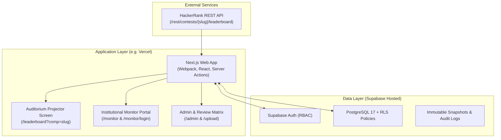

# Code Clash 2026: Production Deployment & Event-Day Runbook

This document is the official operational guide for deploying the **Code Clash Leaderboard (v2 Centralized Architecture)** to production and running the live competition.

---

## 1. System Requirements & Architecture Overview



---

## 2. Pre-Deployment Checklist

### A. Prerequisites
1. **GitHub Repository**: `toxicbishop/CodeClash-LeaderBoard` (`main` branch).
2. **Hosted Supabase Project**: Created at [supabase.com](https://supabase.com).
3. **Hosting Account**: Vercel (recommended) or any Node.js hosting platform.
4. **HackerRank Organizer Account**:
   - Public or private contest slugs created for each contest set and round (e.g., `codeclash-2026-round1-seta`, `codeclash-2026-round2-seta`).
   - If private, ensure you have access to the `_hr_session` session cookie.

---

## 3. Remote Supabase Setup

### Step 1: Link and Apply Database Migrations
From the repository root on your local machine:
```sh
# Authenticate with Supabase CLI
supabase login

# Link your local repository to your remote hosted project
supabase link --project-ref <your-project-ref>

# Push all migrations to production database
supabase db push
```
*This executes all migration files in `supabase/migrations/`, including:*
- *`20261121000000_v2_centralized_schema.sql` — core tables, RLS policies, `public_leaderboard` view*
- *`20261128000000_multi_round_support.sql` — adds `round_number` to `contest_sets` and `leaderboard_snapshots`, updates uniqueness constraints*

> [!NOTE]
> If Docker is unavailable locally, apply migrations directly using the `DATABASE_URL` from your Supabase project settings with any PostgreSQL client (e.g., `psql`, DataGrip, or a Node.js script using `pg`).

### Step 2: Configure Supabase Auth Settings
In the Supabase Dashboard:
1. Navigate to **Authentication → Providers → Email**.
2. **CRITICAL**: Toggle **OFF** `Allow new users to sign up`. (Accounts must only be provisioned by the Super Admin via seed scripts or `/admin/users/new`).
3. Set **Rate Limits**:
   - `Sign-ins per 5 minutes per IP`: Set to `60` or higher to prevent auditorium/lab IP throttling if testing on a shared network.

---

## 4. Production Account Provisioning (Initial Seed)

Before opening the app to staff, run the seed scripts with production credentials:

```sh
# In your secure environment (or temporarily in .env.local pointing to remote Supabase):
NEXT_PUBLIC_SUPABASE_URL=https://<your-project-ref>.supabase.co
NEXT_PUBLIC_SUPABASE_ANON_KEY=<production-anon-key>
SUPABASE_SERVICE_ROLE_KEY=<production-service-role-key>

# Super Admin Account
COMPETITION_ADMIN_EMAIL=superadmin@institution.edu
COMPETITION_ADMIN_PASSWORD=<strong-random-password>

# Master Lab Admin
MASTER_LAB_ADMIN_EMAIL=masterlab@institution.edu
MASTER_LAB_ADMIN_PASSWORD=<strong-random-password>

# Institutional Monitors
HOD_EMAIL=hod.cse@institution.edu
HOD_PASSWORD=<strong-random-password>

PRINCIPAL_EMAIL=principal@institution.edu
PRINCIPAL_PASSWORD=<strong-random-password>
```

Run the seeders:
```sh
# Provision Super Admin
pnpm admin:sync

# Provision Master Lab Admin, HOD, and Principal
pnpm seed:monitor
```

---

## 5. Web Application Hosting (Vercel)

### Step 1: Import Project
1. Go to [vercel.com](https://vercel.com) and click **Add New → Project**.
2. Select `toxicbishop/CodeClash-LeaderBoard` with default branch `main`.

### Step 2: Environment Variables
Add the following in Vercel **Project Settings → Environment Variables**:
| Variable Name | Value | Scope |
| :--- | :--- | :--- |
| `NEXT_PUBLIC_SUPABASE_URL` | `https://<your-project-ref>.supabase.co` | Production, Preview |
| `NEXT_PUBLIC_SUPABASE_ANON_KEY` | Your remote Supabase anon key | Production, Preview |
| `SUPABASE_SERVICE_ROLE_KEY` | Your remote Supabase service role key | Production, Preview |
| `NEXT_TELEMETRY_DISABLED` | `1` | Production, Preview |

### Step 3: Build & Output Settings
- **Framework Preset**: Next.js
- **Build Command**: `pnpm build`
- **Output Directory**: `.next`
- **Node.js Version**: `20.x` or `24.x`

Click **Deploy**.

---

## 6. Contest Configuration Walkthrough

### Step 1: Create the Competition
1. Log in to the production deployment at `/` using the **Super Admin** credentials.
2. Navigate to `/admin/competitions/new`.
3. Provide:
   - **Competition Name**: e.g., `Code Clash 2026 Finals`
   - **Contest Date**: Event date
   - **Top-K Cutoff**: e.g., `10` (Qualifies Top 10 contestants for next round)
4. Click **Create Competition**.

### Step 2: Register Contest Sets with Rounds
For each contest set (`Set A`, `Set B`, `Set C`, `Set D`) and each round:
1. On the competition detail page, click **+ Add Set**.
2. Select the **Number of Rounds** using the pill buttons (`1`, `2`, `3`, `4`).
3. For each round, enter the corresponding **HackerRank Slug** (e.g., `codeclash-2026-round1-seta` for Round 1 of Set A).
4. Enter:
   - **Set Name**: `Set A`
   - **Set Code**: `setA`
   - **HackerRank Session Cookie** *(Only if contest is private)*:
     - Inspect your browser cookies on `hackerrank.com` while logged in as contest organizer.
     - Copy the value of the `_hr_session` cookie and paste it here. *(Encrypted with AES-256-GCM and stored server-side only.)*
5. Click **Add Set**. This creates one `contest_sets` row per round (e.g., Round 1 `setA`, Round 2 `setA`).
6. Repeat for Sets B, C, and D.

> [!NOTE]
> Rounds are **independent** — scores are not carried forward between rounds. Each round produces its own leaderboard snapshot. The public leaderboard displays round tabs with the active round highlighted.

---

## 7. Event-Day Operational Runbook

```
+----------------------------------------------------------------------------------+
|                             EVENT TIMELINE SCHEDULE                              |
+----------------------------------------------------------------------------------+
| T - 60 min | Pre-Flight Checks: Verify Supabase status & HackerRank API slugs   |
| T - 15 min | Setup Auditorium Display: Open /leaderboard in Projector Mode       |
| T - 00 min | Round 1 Begins (Participants code on HackerRank)                   |
| T + 40 min | Round 1 Ends. Submissions freeze.                                  |
| T + 42 min | Master Lab Admin enables Auto-Sync for Round 1 sets (5 s polling)  |
| T + 47 min | Super Admin reviews, approves, generates & publishes Round 1 snap  |
| T + 48 min | Auditorium Projector auto-refreshes live (5 s interval)            |
| T + 55 min | Round 2 Begins — repeat ingestion steps for Round 2 sets           |
| T + 140 min| HOD & Principal download official signed CSV export                |
+----------------------------------------------------------------------------------+
```

### Detailed Event Steps:

#### 1. Pre-Flight Verification (T - 60 min)
- Super Admin opens `/admin/competitions/[id]`.
- Confirm all sets across all rounds are active with valid HackerRank slugs.
- Run a dry test sync on a test contest set to confirm outbound API connectivity.

#### 2. Projector Screen Setup (T - 15 min)
- On the hall/auditorium presentation PC:
  1. Open the public leaderboard: `https://<your-app-domain>/leaderboard?comp=code-clash-2026-finals`.
  2. Click the **⛶ Projector** button in the control bar.
  3. Click **⛶ Fullscreen**.
  4. Ensure the **● Auto Sync: On (5s)** badge is active.
- *The screen polls for published snapshots every 5 seconds and updates automatically.*

#### 3. Ingestion Phase (Immediately After Each Round Ends)
- **Master Lab Admin** logs in at `/login` (redirects to `/upload`).
- For each set in the completed round, the auto-sync should already be pulling live data every 5 seconds.
- Confirm sync count and last sync timestamp are updating in the lab page.

#### 4. Review & Cross-Set Collision Check
- **Super Admin** opens `/admin/competitions/[id]`.
- For each pending upload, click **Review →**.
- **Collision Detection**: If any participant's HackerRank handle was used in more than one contest set within the same round, an alert banner appears.
- If verified legitimate or resolved, click **Approve Upload**. (If invalid, enter rejection reason and click **Reject**).

#### 5. Ranking Engine & Tie-Breakers
- Super Admin navigates to **⚙ Configure Tie-Breakers** (`/admin/competitions/[id]/rules`).
- Confirm default tie-breaking hierarchy:
  1. Total Score (`DESC`)
  2. Problems Solved (`DESC`)
  3. Cumulative Time Penalty (`ASC`)
  4. Last Accepted Submission Time (`ASC`)
  5. Incorrect Submissions Count (`ASC`)
- Click **Save & Approve Rules**.

#### 6. Consolidation & Official Publication
- Super Admin clicks **⚡ Generate New Snapshot**.
  - The ranking engine computes Olympic shared ranks and identifies Top-K qualifiers.
  - If identical scores exist right at the Top-K cutoff line, contestants are flagged with `⚠️ BOUNDARY_REVIEW`.
- Super Admin reviews draft snapshot v1.
- Super Admin clicks **Publish Live →**.
  - Status transitions to `PUBLISHED`.
  - The live public leaderboard and auditorium projector screens update automatically within **5 seconds**.

#### 7. Institutional Sign-Off & CSV Export
- HOD and Principal log in at `https://<your-app-domain>/monitor/login`.
- Verify competition summary metrics and Set A/B/C/D participant counts per round.
- Click **↓ Download Official CSV** to retrieve the immutable, timestamped audit CSV file with formula injection protection.

---

## 8. Troubleshooting & Incident Response

### Issue A: HackerRank Returns 401 Unauthorized or Empty Ranks
- **Root Cause**: The contest is configured as private on HackerRank and the session cookie expired.
- **Fix**: Log in to HackerRank as contest admin, copy the fresh `_hr_session` cookie, update the set's session cookie in the admin portal, and re-trigger sync.

### Issue B: Participant Appeared in Two Sets (Cross-Set Collision)
- **Root Cause**: Student logged into Set B after starting in Set A within the same round.
- **Fix**: Review timestamp of first submission. Super Admin can reject the duplicate upload or contact the physical lab invigilator.

### Issue C: Tie at Cutoff Line (`⚠️ BOUNDARY_REVIEW`)
- **Root Cause**: Two or more students have identical scores, solve counts, penalties, and submission times right at Rank 10.
- **Fix**: The spec mandates that ties at the boundary require Super Admin evaluation. Super Admin can adjust tie-breaker criteria (e.g. prioritize least incorrect submissions) and regenerate a new snapshot version (v2).

### Issue D: "Could not find the 'round_number' column" Error
- **Root Cause**: Migration `20261128000000_multi_round_support.sql` has not been applied to the remote database.
- **Fix**: Run `supabase db push` after `supabase login` and `supabase link`, or apply the migration SQL directly via `psql` or any PostgreSQL client using the `DATABASE_URL` from Supabase project settings.
