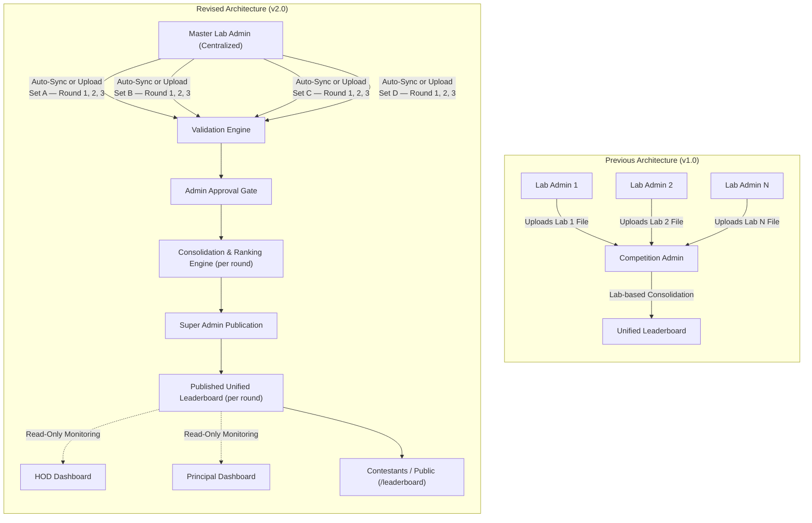
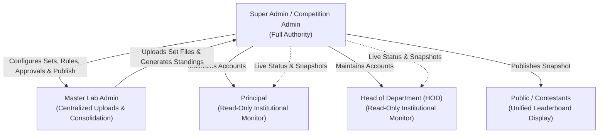

# Project Scope

## System Overview

The **Coding Competition – Centralized Leaderboard Management System** (Version 2.0) is a centralized platform engineered to collect, validate, consolidate, rank, and publish results from departmental coding competitions with **multi-round support**.

The application receives leaderboard data from multiple contest sets across multiple rounds — either via live HackerRank API auto-sync (every **5 seconds**) or file upload — automatically validates data, consolidates candidate scores into a unified dataset per round, calculates overall rankings using a configurable lexicographical tie-breaking engine, and publishes an authoritative unified leaderboard.

Version 2.0 introduces dedicated, read-only monitoring dashboards for the **Principal** and **HOD** (Head of Department), granting institutional authorities full visibility into competition progress, participant statistics, and leaderboard status without granting data modification privileges.

> [!IMPORTANT]
> Each competition round is **fully independent**. Scores are not cumulated across rounds. Each round produces its own leaderboard snapshot. The public leaderboard displays clickable round tabs; the active round is highlighted with a live pulse indicator.

---

## What Has Changed From the Previous Version?

The original application specification followed a distributed **multi-lab administrative model**, wherein individual lab administrators uploaded partial contest results for their respective physical computer labs. Following a review of the competition structure, the architecture has transitioned to a **centralized contest-set model with multi-round support**.

### Comparison: Previous vs. Revised Architecture

| Component | Previous Approach (v1.0) | Revised Approach (v2.0) |
| :--- | :--- | :--- |
| **Data Collection** | Each physical lab administrator uploads data | One Master Lab Admin ingests all contest-set files via API or upload |
| **Data Organization** | Lab-wise leaderboards | Contest-set-wise, per-round leaderboards |
| **Upload Responsibility** | Multiple independent lab administrators | Single centralized administrator (Master Lab Admin) |
| **Upload Slots** | Based on number of physical labs | Based on `(contest set, round)` combinations |
| **Live Sync** | No live sync | HackerRank API auto-sync every **5 seconds** per set per round |
| **Leaderboard Consolidation** | Combine lab uploads | Combine all contest-set leaderboards within a round into a unified ranking |
| **Round Support** | Single-round | Multi-round (1–4 rounds per set; rounds independent, not cumulated) |
| **Ranking Scope** | Unified ranking across physical lab uploads | Unified ranking across all contest sets per round without fixed per-set quotas |
| **Institutional Monitoring**| Primarily administrator-focused | Dedicated read-only dashboards for Principal and HOD |
| **Permissions Model** | Lab-admin-oriented segregation | Centralized admin + strict read-only institutional monitoring roles |
| **Publication Workflow** | Administrator-controlled | Controlled approval, immutable per-round snapshots, and audited publication |

### Deprecated & Removed Requirements

The following requirements from the previous version have been superseded and removed from the active architecture:
* Individual lab administrator accounts for uploading leaderboard files.
* Separate upload dashboards partitioned per physical laboratory.
* Lab-wise upload ownership, quota allocation, and per-lab approval workflows.
* Lab-based consolidation logic and lab-specific ranking as the primary ranking mechanism.

The revised system organizes uploads around **contest sets and rounds**, not physical laboratories.

---

## Revised Competition Structure

In the baseline competition model, contest questions are divided into independent contest sets, each running across multiple rounds:

* **Set A** — Round 1, Round 2, Round 3 (each with a distinct HackerRank slug)
* **Set B** — Round 1, Round 2, Round 3
* **Set C** — Round 1, Round 2, Round 3
* **Set D** — Round 1, Round 2, Round 3

Each contest-set link is used simultaneously by contestants across multiple physical laboratories to prevent visual collusion. The export file (or API response) for a given `(set, round)` already contains participant records spanning all laboratories using that set.

| Contest Set | Participating Labs | Uploaded Leaderboard |
| :--- | :--- | :--- |
| **Set A — Round 1** | Lab 1, Lab 2, Lab 3, Lab 4 | Auto-sync / File A Round 1 |
| **Set B — Round 1** | Lab 1, Lab 2, Lab 3, Lab 4 | Auto-sync / File B Round 1 |
| **Set C — Round 1** | Lab 1, Lab 2, Lab 3, Lab 4 | Auto-sync / File C Round 1 |
| **Set D — Round 1** | Lab 1, Lab 2, Lab 3, Lab 4 | Auto-sync / File D Round 1 |

> [!IMPORTANT]
> The system supports a **configurable number of contest sets** (not hardcoded to 4) and a **configurable number of rounds per set** (1–4, selected via pill buttons when adding a set). The uniqueness constraint is `UNIQUE (competition_id, round_number, set_code)`.

---

## User Roles & Responsibilities

The system defines four authenticated user roles and a public viewer tier:

### 1. Super Admin / Competition Admin
* Possesses complete administrative authority over the system.
* Creates and configures competitions, contest sets (with rounds), and qualification parameters (Top-K value).
* Approves auto-sync requests from Master Lab Admin per `(set, round)`.
* Manages user accounts and role assignments.
* Inspects uploaded files and automated validation reports across all contest sets and rounds.
* Approves or rejects uploaded files.
* Reviews and approves the ranking rules and tie-breaking configuration.
* Reviews the consolidated leaderboard and triggers official publication per round.
* Inspects system audit logs and manages post-publication corrections.

### 2. Master Lab Admin
* Serves as the central operational manager for leaderboard data ingestion.
* Accesses the centralized upload dashboard with dedicated slots for each `(set, round)` combination.
* Requests Super Admin approval to enable live HackerRank API auto-sync (polls every **5 seconds**).
* Uploads leaderboard files for each `(set, round)` as an alternative to auto-sync.
* Inspects real-time validation reports; corrects and re-uploads invalid files.
* Proposes or tunes ranking and tie-breaking criteria (subject to Super Admin approval).
* Generates the consolidated leaderboard once all required sets for a round are approved.
* Cannot publish the leaderboard independently without Super Admin authorization.

### 3. Head of Department (HOD)
* Dedicated, read-only institutional monitoring dashboard.
* Monitors overall competition progress, participant metrics, and upload completion per round.
* Inspects individual set-wise leaderboards and switches between rounds and sets.
* Views the draft and published unified leaderboard, including Top-K qualified participants.
* Inspects the configured ranking methodology and tie-breaking criteria for transparency.
* Cannot upload, modify, delete data, or publish results.

### 4. Principal
* Dedicated, read-only institutional oversight dashboard.
* Monitors campus-wide competition metrics and total participant counts.
* Observes contest-set upload and approval statuses per round.
* Inspects set-wise and unified rankings, Top-K rosters, and applied tie-breaking rules.
* Strictly read-only access enforced on the backend via Supabase RLS.

### 5. Public / Contestants / Spectators
* Views the unified published leaderboard via `/leaderboard` or `/competitions/[slug]/leaderboard`.
* Navigates round tabs — completed rounds shown as greyed-out; the active round shows a green pulse.
* Uses real-time search, set-filtering, and CSV/print export tools.
* Leaderboard auto-refreshes every **5 seconds** when Auto Sync is enabled.

---

## Event Context: Code Clash 2026

While designed as a generic, reusable competition management platform, the primary baseline event is **Code Clash 2026**:
* **Contest Platform:** HackerRank Community.
* **Participant Distribution:** Python 3 standard contest baseline across multiple physical laboratories.
* **Contest Structure:**
  * **Round 1 (Easy):** 40 minutes | 10 questions (2 marks each) = 20 marks max.
  * **Round 2 (Medium):** 50 minutes | 5 questions (6 marks each) = 30 marks max.
  * **Round 3 (Hard):** 60 minutes | 3 questions (15, 15, 20 marks) = 50 marks max.
  * **Total Contest:** 150 minutes | 18 questions | 100 marks maximum.
* **Contest Sets:** 4 independent sets (Sets A, B, C, D) partitioned across laboratories to prevent collusion.
* **Rounds per Set:** 3 rounds, each with an independent HackerRank slug. Scores are **not** carried forward between rounds.

---

## Scope Boundaries

### In Scope
* Multi-competition configuration with dynamic, configurable contest sets and rounds.
* Live HackerRank API auto-sync at **5-second** intervals per `(set, round)`.
* Centralized Master Lab Admin upload console supporting CSV and XLSX files.
* Dynamic column mapping for arbitrary leaderboard formats (HackerRank CSV/Excel).
* Comprehensive file validation: schema integrity, numeric checks, row error reporting, and cross-set duplicate participant detection.
* Configurable lexicographical ranking engine supporting dynamic tie-breaking priorities.
* Shared rank support (e.g., 1, 2, 2, 4) and configurable Top-K boundary tie handling.
* Super Admin approval gates and immutable published snapshot versioning per round (`v1.0`, `v2.0`).
* Dedicated read-only monitoring dashboards for Principal and HOD.
* High-contrast public/contestant unified leaderboard with round tabs, search, set filtering, 5 s auto-refresh, and CSV exports.
* Complete system audit trails for administrative accountability.

### Out of Scope
* Direct code compilation, execution, or automated test-case evaluation (handled externally on HackerRank).
* Automated contest scheduling or question authoring on third-party platforms.
* Code similarity or plagiarism detection (conducted prior to leaderboard ingestion).
* Multi-lab hardware and physical networking management.
* Score accumulation or carry-forward across rounds.
