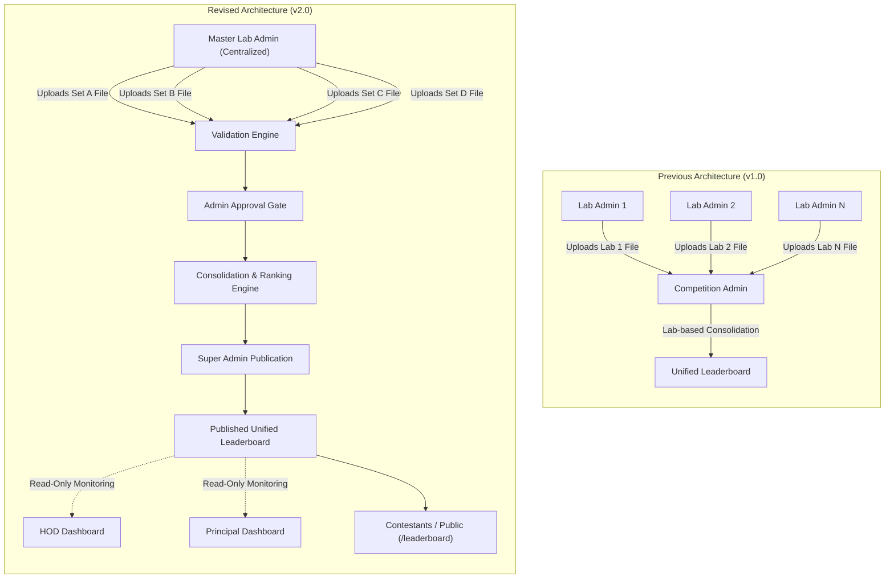
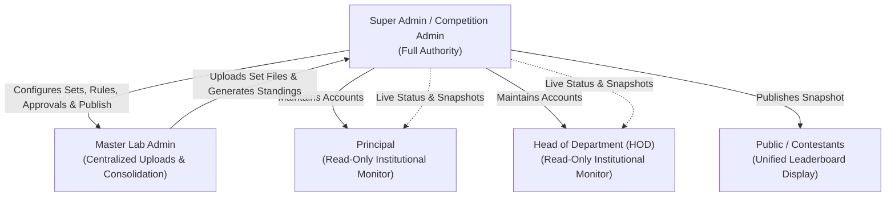

# Project Scope

## System Overview

The **Coding Competition – Centralized Leaderboard Management System** (Version 2.0) is a centralized platform engineered to collect, validate, consolidate, rank, and publish results from departmental coding competitions.

The application receives leaderboard data from multiple contest sets, automatically validates uploaded files, consolidates candidate scores into a unified dataset, calculates overall rankings using a configurable lexicographical tie-breaking engine, and publishes an authoritative unified leaderboard.

Furthermore, Version 2.0 introduces dedicated, read-only monitoring dashboards for the **Principal** and **HOD** (Head of Department), granting institutional authorities full visibility into competition progress, participant statistics, and leaderboard status without granting data modification privileges.

---

## What Has Changed From the Previous Version?

The original application specification followed a distributed **multi-lab administrative model**, wherein individual lab administrators uploaded partial contest results for their respective physical computer labs. Following a review of the competition structure, the architecture has transitioned to a **centralized contest-set model**.

### Comparison: Previous vs. Revised Architecture

| Component | Previous Approach (v1.0) | Revised Approach (v2.0) |
| :--- | :--- | :--- |
| **Data Collection** | Each physical lab administrator uploads data | One Master Lab Admin uploads all contest-set files |
| **Data Organization** | Lab-wise leaderboards | Contest-set-wise leaderboards |
| **Upload Responsibility** | Multiple independent lab administrators | Single centralized administrator (Master Lab Admin) |
| **Upload Slots** | Based on number of physical labs | Based on number of contest sets (e.g., Set A, Set B, Set C, Set D) |
| **Leaderboard Consolidation** | Combine lab uploads | Combine all contest-set leaderboards into a unified ranking |
| **Ranking Scope** | Unified ranking across physical lab uploads | Unified ranking across all contest sets without fixed per-set quotas |
| **Institutional Monitoring**| Primarily administrator-focused | Dedicated read-only dashboards for Principal and HOD |
| **Permissions Model** | Lab-admin-oriented segregation | Centralized admin + strict read-only institutional monitoring roles |
| **Publication Workflow** | Administrator-controlled | Controlled approval, immutable snapshots, and audited publication |

### Deprecated & Removed Requirements

The following requirements from the previous version have been superseded and removed from the active architecture:
* Individual lab administrator accounts for uploading leaderboard files.
* Separate upload dashboards partitioned per physical laboratory.
* Lab-wise upload ownership, quota allocation, and per-lab approval workflows.
* Lab-based consolidation logic and lab-specific ranking as the primary ranking mechanism.

The revised system organizes uploads around **contest sets**, not physical laboratories.

---

## Revised Competition Structure

In the baseline competition model, contest questions are divided into independent contest sets:

* **Set A** (`/setA`)
* **Set B** (`/setB`)
* **Set C** (`/setC`)
* **Set D** (`/setD`)

Each contest-set link is utilized simultaneously by contestants seated across multiple physical laboratories to prevent visual collusion. Consequently, the export file generated for a given contest set already contains participant records spanning all laboratories using that set.

| Contest Set | Participating Labs | Uploaded Leaderboard |
| :--- | :--- | :--- |
| **Set A** | Lab 1, Lab 2, Lab 3, Lab 4 | File A (Set A Export) |
| **Set B** | Lab 1, Lab 2, Lab 3, Lab 4 | File B (Set B Export) |
| **Set C** | Lab 1, Lab 2, Lab 3, Lab 4 | File C (Set C Export) |
| **Set D** | Lab 1, Lab 2, Lab 3, Lab 4 | File D (Set D Export) |

> [!IMPORTANT]
> The system must support a **configurable number of contest sets**. While the baseline competition uses four sets (A–D), the platform must not hardcode four as a permanent constraint.

---

## User Roles & Responsibilities

The system defines four authenticated user roles and a public viewer tier:

### 1. Super Admin / Competition Admin
* Possesses complete administrative authority over the system.
* Creates and configures competitions, contest sets, and qualification parameters (Top-K value).
* Manages user accounts and role assignments.
* Assigns and oversees the Master Lab Admin.
* Inspects uploaded files and automated validation reports across all contest sets.
* Approves or rejects uploaded files.
* Reviews and approves the ranking rules and tie-breaking configuration.
* Reviews the consolidated leaderboard and triggers official publication.
* Inspects system audit logs and manages post-publication corrections.

### 2. Master Lab Admin
* Serves as the central operational manager for leaderboard data ingestion.
* Accesses the centralized upload dashboard with dedicated slots for each contest set.
* Uploads leaderboard files for each contest set (files may be uploaded asynchronously in any order).
* Inspects real-time validation reports; corrects and re-uploads invalid files.
* Proposes or tunes ranking and tie-breaking criteria (subject to Super Admin approval).
* Generates the consolidated leaderboard once all required sets are approved.
* Reviews the consolidated standings prior to final administrative sign-off.
* Cannot publish the leaderboard independently without Super Admin authorization.

### 3. Head of Department (HOD)
* Dedicated, read-only institutional monitoring dashboard.
* Monitors overall competition progress, participant metrics, and upload completion.
* Inspects individual set-wise leaderboards and switching between Set A, B, C, D.
* Views the draft and published unified leaderboard, including Top-K qualified participants.
* Inspects the configured ranking methodology and tie-breaking criteria for transparency.
* Tracks approval and publication milestones.
* Optionally exports summary reports.
* Cannot upload, modify, delete data, or publish results.

### 4. Principal
* Dedicated, read-only institutional oversight dashboard.
* Monitors campus-wide competition metrics and total participant counts.
* Observes contest-set upload and approval statuses.
* Inspects set-wise and unified rankings, Top-K rosters, and applied tie-breaking rules.
* Tracks the formal result publication status.
* Optionally exports leaderboard summaries.
* Strictly read-only access enforced on the backend.

### 5. Public / Contestants / Spectators
* Views the unified published leaderboard via the simplified `/leaderboard` route (or `/competitions/[slug]/leaderboard`).
* Inspects rank, participant name, participant ID, contest set, score, problems solved, and Top-K qualification badges.
* Uses real-time search, set-filtering, and CSV/Excel/print export tools.

---

## Event Context: Code Clash 2026

While designed as a generic, reusable competition management platform, the primary baseline event is **Code Clash 2026**:
* **Contest Platform:** HackerRank Community.
* **Participant Distribution:** Python 3 standard contest baseline across multiple physical laboratories.
* **Contest Structure:**
  * **Round 1 (Easy):** 40 minutes | 10 questions (2 marks each) = 20 marks max.
  * **Round 2 (Medium):** 50 minutes | 5 questions (6 marks each) = 30 marks max.
  * **Round 3 (Hard):** 60 minutes | 3 questions (15, 15, 20 marks) = 50 marks max.
  * **Total Contest:** 150 minutes | 18 questions | 100 marks maximum.
* **Contest Sets:** 4 independent sets (Sets A, B, C, D) partitioned across laboratories to prevent collusion.

---

## Scope Boundaries

### In Scope
* Multi-competition configuration with dynamic, configurable contest sets.
* Centralized Master Lab Admin upload console supporting CSV and XLSX files.
* Dynamic column mapping for arbitrary leaderboard formats (HackerRank CSV/Excel).
* Comprehensive file validation: schema integrity, numeric checks, row error reporting, and cross-set duplicate participant detection.
* Configurable lexicographical ranking engine supporting dynamic tie-breaking priorities.
* Shared rank support (e.g., 1, 2, 2, 4) and configurable Top-K boundary tie handling.
* Super Admin approval gates and immutable published snapshot versioning (`v1.0`, `v2.0`).
* Dedicated read-only monitoring dashboards for Principal and HOD.
* High-contrast public/contestant unified leaderboard with search, set filtering, and exports.
* Complete system audit trails for administrative accountability.

### Out of Scope
* Direct code compilation, execution, or automated test-case evaluation (handled externally on HackerRank).
* Automated contest scheduling or question authoring on third-party platforms.
* Code similarity or plagiarism detection (conducted prior to leaderboard ingestion).
* Multi-lab hardware and physical networking management.
