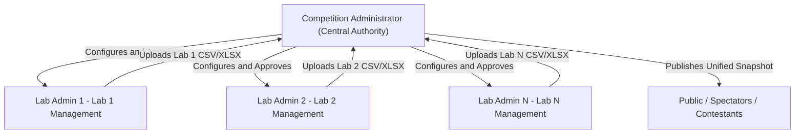

# Project Scope

## System Overview

The **Multi-Lab Contest Leaderboard Management System** is a centralized platform engineered to collect, validate, consolidate, rank, and publish results from multi-laboratory programming contests. 

When coding competitions are distributed across multiple physical computer labs, each lab typically operates its own contest instance or leaderboard. Consolidating these results manually via separate spreadsheets introduces data-entry errors, duplicate entries, inconsistent tie-breaking, and critical delays. This application automates the end-to-end result consolidation process while providing strict role-based access control.

---

## Core Concept

1. **Independent Uploads:** Each lab administrator independently manages and submits their lab's contest leaderboard (`.csv` or `.xlsx`).
2. **Data Validation:** The platform validates records, detects formatting errors, flags duplicates within the lab, and identifies cross-lab participant collisions.
3. **Centralized Approval:** The competition administrator reviews incoming submissions and validation reports, approving clean datasets or rejecting flawed uploads with correction requests.
4. **Automated Consolidation & Ranking:** Approved lab records are merged into a unified competition dataset, evaluated against global scoring and tie-breaking rules, and assigned global ranks.
5. **Unified Top-K Publication:** A single, authoritative leaderboard highlighting the overall Top-K contestants is published and accessible across all participating labs, spectators, and projector displays.

---

## User Roles & Responsibilities

### 1. Competition Administrator (Super Admin)
* Creates and manages multiple competitions over time.
* Dynamically registers participating labs and provisions lab administrator accounts.
* Sets submission deadlines, scoring policies, and qualification limits (Top-K value).
* Monitors real-time upload progress across all labs from a centralized status matrix.
* Inspects data validation reports, reviews raw files, and approves or rejects submissions.
* Executes consolidation, calculates unified rankings, and publishes/unpublishes the leaderboard.
* Exports final competition audit logs and results.

### 2. Lab Administrator
* Receives credentials created/assigned by the competition administrator (unrestricted self-registration is disabled).
* Accesses a dedicated dashboard strictly scoped to their assigned lab.
* Uploads the lab's contest leaderboard file (`.csv` or `.xlsx`).
* Maps arbitrary source columns (e.g., from HackerRank exports) to standardized internal fields.
* Previews parsed data and reviews validation errors or warnings.
* Corrects and re-uploads data prior to administrator approval.
* Accesses the published unified leaderboard once released.
* **Access Boundary:** A lab administrator cannot view, modify, upload, or delete data belonging to any other lab.

### 3. Public / Contestants / Spectators
* Views the live or finalized unified leaderboard on projector screens or web browsers via a shared competition URL.
* Filters by lab, searches participants, and inspects Top-K qualification badges.

---

## Event Context: Code Clash 2026

While designed as a reusable multi-competition platform, the immediate event baseline is **Code Clash 2026**:

* **Contest Platform:** HackerRank Community.
* **Environment:** Contestants write complete Python programs with standard input/output.
* **Rounds & Durations:**
  * **Round 1 (Easy):** 40 minutes | 10 questions (2 marks each) = 20 marks max.
  * **Round 2 (Medium):** 50 minutes | 5 questions (6 marks each) = 30 marks max.
  * **Round 3 (Hard):** 60 minutes | 3 questions (15, 15, 20 marks) = 50 marks max.
  * **Total Contest Time:** 150 minutes (excluding setup/breaks) | 18 questions | 100 marks maximum.
* **Lab Partitioning:** Multiple physical labs, each assigned distinct question sets (Sets A–D) to prevent visual collusion.

---

## Scope Boundaries

* **In Scope:**
  * Multi-competition lifecycle management.
  * Multi-lab admin provisioning and authorization.
  * CSV and Excel file ingestion with dynamic column mapping.
  * Row-level validation and cross-lab duplicate detection.
  * Configurable scoring and tie-breaking algorithms.
  * Top-K participant qualification indicators.
  * Single unified leaderboard with search, lab filtering, and CSV/Excel/print export.
  * Versioned publication history and audit trails.
* **Out of Scope:**
  * Code submission, compilation, and automated test-case evaluation (handled entirely on HackerRank).
  * Direct contest authoring or automated contest scheduling on HackerRank.
  * Plagiarism code-similarity analysis (handled prior to or outside leaderboard ingestion).
