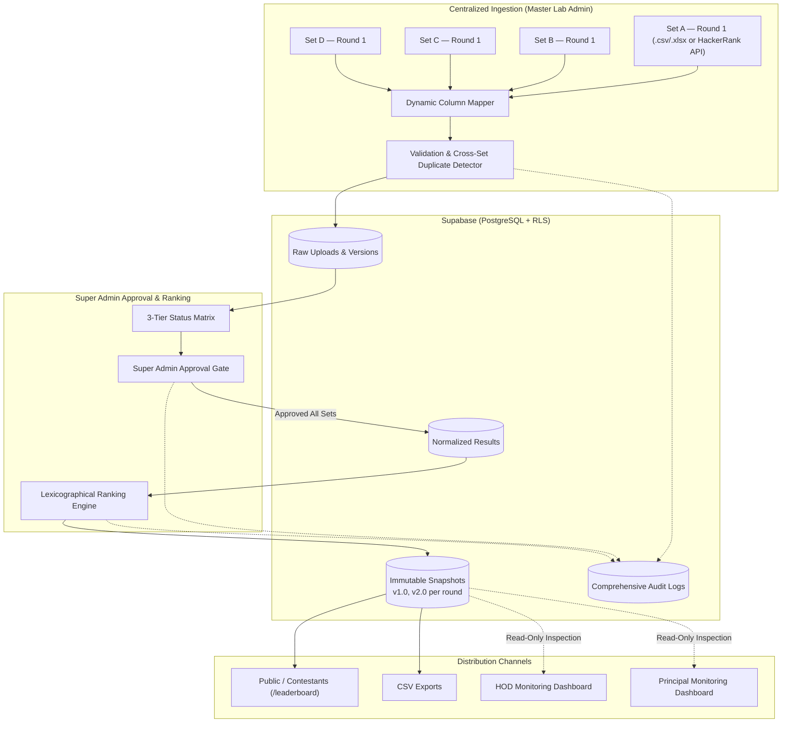

# Tech Stack and Architecture

## Architectural Summary

The system is a modular, type-safe full-stack web application implementing the centralized leaderboard management platform. It uses **Next.js (App Router), React, TypeScript, Tailwind CSS, and Supabase (PostgreSQL + Auth + Row-Level Security)** as its primary stack.

This architecture provides unified end-to-end type safety between the ingestion service, relational database schemas, and client interfaces, while delivering high-performance rendering for auditorium displays, administrative consoles, and institutional monitoring dashboards.

---

## Technology Matrix

| Layer | Technology | Version / Tool | Responsibility |
| :--- | :--- | :--- | :--- |
| **Web Framework** | Next.js (App Router) | 15+ | Full-stack routing, Server Actions, Server Components, and REST API route handlers |
| **UI Library** | React | 19+ | Reactive, accessible administrative, monitoring, and leaderboard components |
| **Language** | TypeScript | 5+ | Shared type definitions across models, validators, and endpoints |
| **Styling** | Tailwind CSS | 4+ (PostCSS) | High-contrast projector displays, responsive admin and monitoring layouts |
| **Database** | PostgreSQL | 17 (via Supabase) | ACID-compliant storage for users, contest sets, uploads, results, and immutable snapshots |
| **BaaS / Auth** | Supabase | Hosted | PostgreSQL hosting, Auth (email/password, session tokens), Row-Level Security policies |
| **Data Access** | Supabase JS Client | `@supabase/supabase-js` | Typed queries, session management, server-side service-role client for privileged operations |
| **File Parsing** | `papaparse` / `read-excel-file` | Node.js | Streaming CSV and Excel (`.xlsx`) parsing and normalization |
| **Package Manager**| pnpm | 11.10.0 | Deterministic, fast workspace package management |
| **Linting** | ESLint | Latest | Code quality enforcement across the codebase |
| **Testing** | Vitest + Playwright | Latest | Server action permission tests (68 cases) + browser sign-in E2E |
| **CI** | GitHub Actions | — | Lint, typecheck, build, E2E, Semgrep SAST, dependency audit |
| **Hosting (Target)** | Vercel | Node.js | Edge-compatible deployment with automatic preview environments |

---

## Application Route Structure

### 1. Public & Contestant Routes
* `/`: Home landing page, active competition status, and quick links to the leaderboard and sign-in portal.
* `/leaderboard`: Simplified, direct unified leaderboard route for contestants and auditorium displays.
* `/competitions/[slug]/leaderboard`: Detailed competition leaderboard with **per-round tabs**, contestant search, podium views, 5-second auto-refresh, and CSV exports.

### 2. Authentication
* `/login`: Unified login portal redirecting users to their designated view based on role (`SUPER_ADMIN`, `MASTER_LAB_ADMIN`, `HOD`, or `PRINCIPAL`).

### 3. Master Lab Admin Console (`/upload`)
* Upload dashboard listing contest sets per round for the active competition.
* **Live HackerRank API auto-sync** polling every **5 seconds** when enabled.
* Approval workflow: sets require Super Admin approval before auto-sync is activated.
* Re-upload controls that create versioned uploads (`v1`, `v2`).

### 4. Competition Administrator Portal (`/admin`)
* `/admin`: Master operational dashboard displaying real-time upload status across all contest sets and rounds.
* `/admin/competitions`: Competition creation, scheduling, and Top-K settings.
* `/admin/competitions/[id]/sets/new`: Multi-round contest set creation — select number of rounds (1–4) via pill selector; enter a distinct HackerRank slug for each round.
* `/admin/competitions/[id]/submissions`: Submission review — validation summaries, row-level errors, **Approve** / **Reject** actions.
* `/admin/competitions/[id]/rules`: Configurable lexicographical tie-breaking engine.
* `/admin/competitions/[id]/leaderboard`: Formal snapshot generation, approval, and publication.

### 5. Principal & HOD Monitoring Portal (`/monitor`)
* `/monitor`: Dedicated read-only institutional monitoring dashboard.
* Overview statistics: total participants, contest set counts, upload and approval completion, publication state.
* **Set-Wise & Round Tab Switcher**: Switch between rounds and sets to inspect specific leaderboards.
* Strictly read-only; administrative mutation endpoints return 403 on the server.

---

## Real-Time Sync Architecture

Both the lab ingestion page and the public leaderboard use polling-based live sync:

| Surface | Interval | Trigger |
| :--- | :--- | :--- |
| **Lab auto-sync** (`/upload/[setId]`) | **5 seconds** | Active when `auto_sync_status = 'APPROVED'` |
| **Leaderboard auto-refresh** (`/competitions/[slug]/leaderboard`) | **5 seconds** | Active when "Auto Sync" toggle is ON |

The lab sync fetches live standings from the HackerRank REST API, deduplicates within-round entries (keeping the entry with the lower penalty), writes results to Supabase, and triggers an immediate leaderboard cache invalidation.

---

## Data Pipeline & Architecture

---

## Build & Local Development Settings

* **Bundler:** Webpack mode (`next dev --webpack` / `next build --webpack`) with `@tailwindcss/postcss` for cross-platform Windows compatibility.
* **Prerender Guardrails:** Dynamic client rendering is isolated to `'use client'` components to prevent SSR hydration mismatches.
* **Security & Input Validation:** File uploads are verified by inspecting magic buffer bytes before storage. HackerRank API client includes SSRF protection and hostname allow-listing.
* **AES-256-GCM Encryption:** HackerRank session cookies are encrypted at rest using AES-256-GCM before being stored in Supabase.
