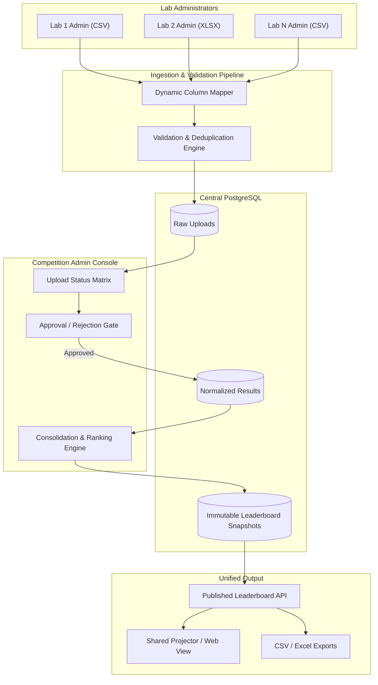

# Tech Stack and Architecture

## Architectural Summary

The system is designed as a modular, type-safe full-stack web application. While the conceptual design in `Leaderboard_Developer_Doc.docx` referenced a Flask/Bootstrap implementation, this repository implements the architecture using **Next.js (App Router), React 19, TypeScript, Tailwind CSS, Prisma, and PostgreSQL**. 

This stack provides unified type sharing between the ingestion engine, database models, and the real-time client UI, while offering superior performance for projector displays.

---

## Technology Matrix

| Layer | Technology | Version / Tool | Responsibility |
| :--- | :--- | :--- | :--- |
| **Web Framework** | Next.js (App Router) | 16.4.6 | Full-stack routing, Server Actions, and REST API route handlers |
| **UI Library** | React | 19.3.1 | Reactive, accessible administrative and leaderboard components |
| **Language** | TypeScript | 6.0.3 | Shared type definitions across models, validators, and endpoints |
| **Styling** | Tailwind CSS | 4.3.5 (PostCSS) | High-contrast projector displays, responsive admin layouts |
| **Database** | PostgreSQL | 16+ | ACID-compliant storage for users, labs, uploads, and immutable snapshots |
| **ORM / Data Access**| Prisma ORM | Latest | Schema migrations, typed queries, and relational data modeling |
| **File Parsing** | `xlsx` / `papaparse` | Node.js | Fast streaming CSV and Excel (`.xlsx`) parsing and normalization |
| **Authentication** | Session / Auth.js | NextAuth / Iron-Session | Role-Based Access Control (`COMPETITION_ADMIN`, `LAB_ADMIN`) |
| **Package Manager**| pnpm | 11.10.0 | Deterministic, fast workspace package management |
| **Hosting (Target)** | Railway / Docker | Persistent Services | Persistent web server, secure storage for raw uploads, and PostgreSQL |

---

## Application Route Structure

### 1. Public & Contestant Routes
* `/`: System index and active competition discovery.
* `/competitions/[id]/leaderboard`: The shared, projector-friendly unified leaderboard showing official Top-K rankings, search, lab filters, and download actions.

### 2. Authentication
* `/login`: Unified login portal redirecting to respective dashboards based on role.

### 3. Lab Administrator Portal (`/lab-admin`)
* `/lab-admin`: Overview of assigned competition, lab profile, and upload status.
* `/lab-admin/upload`: Drag-and-drop file upload interface for `.csv` and `.xlsx` files.
* `/lab-admin/mapping`: Interactive column mapping interface.
* `/lab-admin/preview`: Ingested records preview, row-level validation reports, and submission confirmation.
* `/lab-admin/history`: Version history of past uploads and review feedback.

### 4. Competition Administrator Portal (`/admin`)
* `/admin`: Master dashboard displaying the multi-lab upload status matrix and participant statistics.
* `/admin/competitions`: Competition creation, scheduling, Top-K settings, and scoring rule configuration.
* `/admin/competitions/[id]/labs`: Lab creation, quota management, and lab administrator account assignment.
* `/admin/competitions/[id]/submissions`: Review interface to inspect raw files, check validation reports, and execute **Approve** or **Reject** actions.
* `/admin/competitions/[id]/consolidate`: Trigger ranking calculation, resolve cross-lab duplicates, and preview consolidated standings.
* `/admin/competitions/[id]/publish`: Formal publication controls, snapshot versioning, and export generator.

---

## REST API Specification

The backend exposes a modular REST API consumed by both frontend views and automated test suites:

| Method | Endpoint | Access Role | Description |
| :--- | :--- | :--- | :--- |
| `POST` | `/api/auth/login` | Public | Authenticates credentials and issues session cookie |
| `POST` | `/api/auth/logout` | Authenticated | Terminates active session |
| `GET` | `/api/competitions` | Authenticated | Lists all competitions |
| `POST` | `/api/competitions` | `COMPETITION_ADMIN` | Creates a new competition |
| `POST` | `/api/competitions/:id/labs` | `COMPETITION_ADMIN` | Adds a participating lab to a competition |
| `GET` | `/api/labs/my-lab` | `LAB_ADMIN` | Retrieves the lab assigned to the logged-in administrator |
| `POST` | `/api/labs/:id/uploads` | `LAB_ADMIN` | Uploads a leaderboard `.csv` or `.xlsx` file |
| `GET` | `/api/uploads/:id/preview` | Authenticated | Returns parsed records preview |
| `GET` | `/api/uploads/:id/validation` | Authenticated | Returns detailed validation and error report |
| `POST` | `/api/uploads/:id/approve` | `COMPETITION_ADMIN` | Approves a submitted lab upload |
| `POST` | `/api/uploads/:id/reject` | `COMPETITION_ADMIN` | Rejects upload and provides feedback |
| `GET` | `/api/competitions/:id/upload-status` | `COMPETITION_ADMIN` | Retrieves real-time upload status matrix across labs |
| `POST` | `/api/competitions/:id/generate` | `COMPETITION_ADMIN` | Executes consolidation and ranking algorithm |
| `GET` | `/api/competitions/:id/leaderboard` | Public / Restr. | Retrieves latest published leaderboard snapshot |
| `POST` | `/api/competitions/:id/publish` | `COMPETITION_ADMIN` | Publishes draft leaderboard snapshot |
| `GET` | `/api/competitions/:id/leaderboard/export`| Public / Restr. | Exports leaderboard in CSV or Excel format |

---

## Data Pipeline & Architecture

---

## Build & Local Development Settings

* **Bundler Configuration:** Webpack mode (`next dev --webpack` and `next build --webpack`) with `@tailwindcss/postcss` is enforced to ensure cross-platform compatibility on Windows development environments.
* **Security & Input Validation:** Zod is used for API request schema validation, and file uploads are verified by reading magic buffer bytes before storage.
