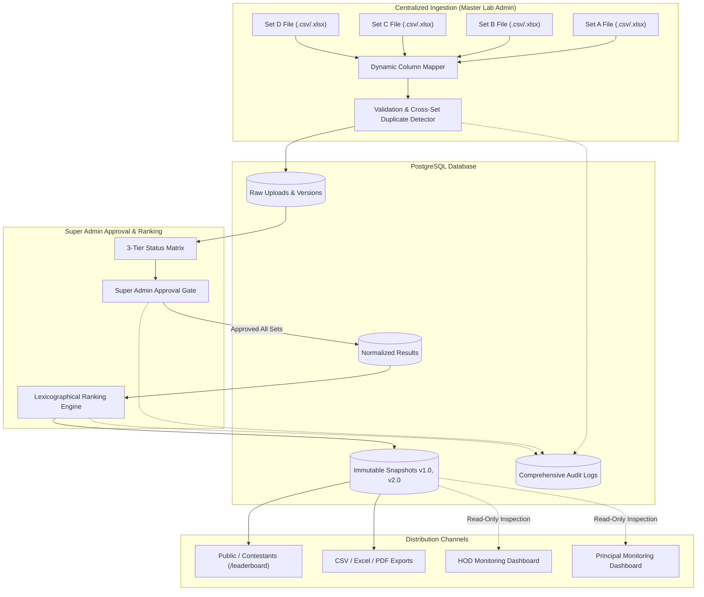

# Tech Stack and Architecture

## Architectural Summary

The system is designed as a modular, type-safe full-stack web application implementing Version 2.0 of `Revised_LeaderBoardManagement(CodeClash).docx`. While the conceptual specification in the developer document references a Flask/Bootstrap/PostgreSQL architecture, this repository implements the design using **Next.js 16 (App Router), React 19, TypeScript, Tailwind CSS, Prisma ORM, and PostgreSQL**.

This modern stack provides unified end-to-end type safety between the ingestion service, relational database schemas, and client user interfaces, while delivering high-performance rendering for auditorium displays, administrative consoles, and read-only institutional monitoring dashboards.

---

## Technology Matrix

| Layer | Technology | Version / Tool | Responsibility |
| :--- | :--- | :--- | :--- |
| **Web Framework** | Next.js (App Router) | 16.4.6 | Full-stack routing, Server Actions, and REST API route handlers |
| **UI Library** | React | 19.3.1 | Reactive, accessible administrative, monitoring, and leaderboard components |
| **Language** | TypeScript | 6.0.3 | Shared type definitions across models, validators, and endpoints |
| **Styling** | Tailwind CSS | 4.3.5 (PostCSS) | High-contrast projector displays, responsive admin and monitoring layouts |
| **Database** | PostgreSQL | 16+ | ACID-compliant storage for users, contest sets, uploads, results, and immutable snapshots |
| **ORM / Data Access**| Prisma ORM | Latest | Schema migrations, typed queries, and relational data modeling |
| **File Parsing** | `xlsx` / `papaparse` | Node.js | Fast streaming CSV and Excel (`.xlsx`) parsing and normalization |
| **Authentication** | Session / Auth.js | NextAuth / Iron-Session | Role-Based Access Control (`SUPER_ADMIN`, `MASTER_LAB_ADMIN`, `HOD`, `PRINCIPAL`) |
| **Package Manager**| pnpm | 11.10.0 | Deterministic, fast workspace package management |
| **Hosting (Target)** | Production Hosting | Node.js / Docker | Persistent web server, private disk storage for raw uploads, and managed PostgreSQL |

---

## Application Route Structure

### 1. Public & Contestant Routes
* `/`: Home landing page, active competition status, and quick links to the leaderboard and sign-in portal.
* `/leaderboard`: Simplified, direct unified leaderboard route for contestants and auditorium displays.
* `/competitions/[slug]/leaderboard`: Detailed competition leaderboard supporting contest-set filtering, participant search, podium views, and CSV/Excel exports.

### 2. Authentication
* `/login`: Unified login portal redirecting users to their designated view based on role (`SUPER_ADMIN`, `MASTER_LAB_ADMIN`, `HOD`, or `PRINCIPAL`).

### 3. Master Lab Admin Console (`/admin/competitions/[id]`)
* Upload dashboard with independent slots for each contest set (Set A, Set B, Set C, Set D).
* Asynchronous upload handling allowing files to be submitted in any order.
* Interactive column mapping interface for CSV and Excel files.
* Parsed records preview and real-time validation issue reports.
* Re-upload controls that create versioned uploads (`v1`, `v2`).
* Trigger consolidation and preview draft consolidated standings once all sets are approved.

### 4. Competition Administrator Portal (`/admin`)
* `/admin`: Master operational dashboard displaying the real-time upload status matrix across all contest sets.
* `/admin/competitions`: Competition creation, scheduling, Top-K settings, and upload policy configuration.
* `/admin/competitions/[id]/sets`: Dynamic contest-set management (creating Sets A, B, C, D, setting URLs).
* `/admin/competitions/[id]/submissions`: Submission review screen to inspect validation summaries, row-level errors, and execute **Approve** or **Reject** actions.
* `/admin/competitions/[id]/ranking-rules`: Configurable lexicographical tie-breaking engine (reordering priorities and toggling ascending/descending directions).
* `/admin/competitions/[id]/publish`: Formal approval, immutable snapshot creation (`v1.0`), and publication controls.

### 5. Principal & HOD Monitoring Portal (`/monitoring`)
* `/monitoring`: Dedicated institutional monitoring dashboard.
* Overview statistics: Total participants ingested, contest sets count, upload completion ($N/N$), approval completion, and publication state.
* **Set-Wise Tab Switcher:** Seamlessly switch between Set A, Set B, Set C, Set D to inspect set-specific leaderboards.
* **Unified Leaderboard View:** Real-time inspection of consolidated rankings and Top-K qualified participants.
* **Ranking Methodology Card:** Transparent display of active tie-breaking criteria in priority order.
* Strictly read-only; administrative mutation endpoints are blocked on the server.

---

## REST API Specification

Matching Section 12 of `Revised_LeaderBoardManagement(CodeClash).docx`:

### 1. Authentication
| Method | Endpoint | Access Role | Description |
| :--- | :--- | :--- | :--- |
| `POST` | `/api/auth/login` | Public | Authenticates credentials and issues secure session |
| `POST` | `/api/auth/logout` | Authenticated | Terminates active session |
| `GET` | `/api/auth/me` | Authenticated | Retrieves current authenticated user profile and role |

### 2. Competition & Contest Set Management
| Method | Endpoint | Access Role | Description |
| :--- | :--- | :--- | :--- |
| `POST` | `/api/competitions` | `SUPER_ADMIN` | Creates a new competition |
| `GET` | `/api/competitions` | Authenticated | Lists all competitions |
| `GET` | `/api/competitions/:id` | Authenticated | Retrieves competition configuration details |
| `PUT` | `/api/competitions/:id` | `SUPER_ADMIN` | Updates competition parameters |
| `POST` | `/api/competitions/:id/sets` | `SUPER_ADMIN` | Creates a new contest set (e.g. Set A) |
| `GET` | `/api/competitions/:id/sets` | Authenticated | Lists all contest sets for a competition |
| `PUT` | `/api/sets/:id` | `SUPER_ADMIN` | Updates contest set configuration |

### 3. File Upload & Administrative Review
| Method | Endpoint | Access Role | Description |
| :--- | :--- | :--- | :--- |
| `POST` | `/api/sets/:id/uploads` | `SUPER_ADMIN`, `MASTER_LAB_ADMIN` | Ingests a `.csv` or `.xlsx` contest-set file |
| `GET` | `/api/sets/:id/uploads` | `SUPER_ADMIN`, `MASTER_LAB_ADMIN` | Lists upload versions for a contest set |
| `GET` | `/api/uploads/:id/preview` | Authenticated | Returns parsed preview rows |
| `GET` | `/api/uploads/:id/validation` | Authenticated | Returns detailed row-by-row validation report |
| `POST` | `/api/uploads/:id/approve` | `SUPER_ADMIN` | Approves an upload for consolidation |
| `POST` | `/api/uploads/:id/reject` | `SUPER_ADMIN` | Rejects an upload with corrective feedback |
| `GET` | `/api/competitions/:id/upload-status`| Authenticated | Retrieves 3-tier status matrix across all sets |

### 4. Ranking Configuration & Consolidation
| Method | Endpoint | Access Role | Description |
| :--- | :--- | :--- | :--- |
| `GET` | `/api/competitions/:id/ranking-rules` | Authenticated | Retrieves active tie-breaking configuration |
| `PUT` | `/api/competitions/:id/ranking-rules` | `SUPER_ADMIN`, `MASTER_LAB_ADMIN` | Proposes or updates ranking criteria |
| `POST` | `/api/competitions/:id/ranking-rules/approve`| `SUPER_ADMIN` | Formally approves ranking criteria |
| `POST` | `/api/competitions/:id/generate` | `SUPER_ADMIN`, `MASTER_LAB_ADMIN` | Executes consolidation and ranking algorithm |
| `GET` | `/api/competitions/:id/leaderboard/preview`| Authenticated | Previews draft consolidated standings |

### 5. Publication & Exports
| Method | Endpoint | Access Role | Description |
| :--- | :--- | :--- | :--- |
| `POST` | `/api/competitions/:id/leaderboard/approve` | `SUPER_ADMIN` | Approves consolidated draft standings |
| `POST` | `/api/competitions/:id/leaderboard/publish` | `SUPER_ADMIN` | Publishes immutable leaderboard snapshot (`v1.0`) |
| `GET` | `/api/competitions/:id/leaderboard` | Public / Restr. | Retrieves latest published leaderboard snapshot |
| `GET` | `/api/competitions/:id/leaderboard/export` | Public / Restr. | Exports leaderboard in CSV or Excel format |
| `GET` | `/api/competitions/:id/leaderboard/versions` | Authenticated | Lists published snapshot version history |

### 6. Institutional Monitoring (Principal & HOD)
| Method | Endpoint | Access Role | Description |
| :--- | :--- | :--- | :--- |
| `GET` | `/api/monitoring/overview` | `PRINCIPAL`, `HOD`, `SUPER_ADMIN` | High-level metrics across all competitions |
| `GET` | `/api/monitoring/competitions/:id/status` | `PRINCIPAL`, `HOD`, `SUPER_ADMIN` | Upload and approval progress for competition |
| `GET` | `/api/monitoring/competitions/:id/sets` | `PRINCIPAL`, `HOD`, `SUPER_ADMIN` | Set-wise leaderboards and stats |
| `GET` | `/api/monitoring/competitions/:id/leaderboard`| `PRINCIPAL`, `HOD`, `SUPER_ADMIN` | Consolidated leaderboard view |
| `GET` | `/api/monitoring/competitions/:id/top-k` | `PRINCIPAL`, `HOD`, `SUPER_ADMIN` | Top-K qualified participants view |
| `GET` | `/api/monitoring/competitions/:id/ranking-rules`| `PRINCIPAL`, `HOD`, `SUPER_ADMIN`| Transparent view of applied ranking criteria |

---

## Data Pipeline & Architecture

---

## Build & Local Development Settings

* **Bundler Configuration:** Webpack mode (`next dev --webpack` and `next build --webpack`) with `@tailwindcss/postcss` is enforced to ensure cross-platform compatibility on Windows development environments.
* **Prerender Guardrails:** Dynamic client rendering is isolated to client components (`'use client'`) to prevent SSR hydration mismatches, and current year calculations in footer components use stable static constants during build time.
* **Security & Input Validation:** Zod is used for API request schema validation, and file uploads are verified by inspecting magic buffer bytes before storage.
