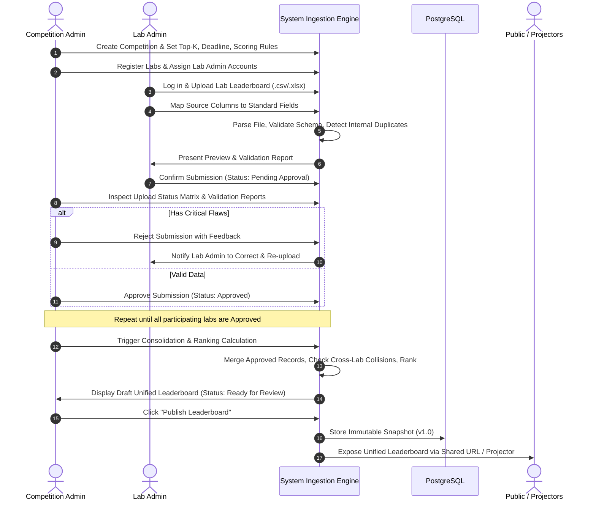

# Operational Workflows

This document specifies the end-to-end operational lifecycle of a multi-lab competition, from initial setup to final leaderboard publication and audit archiving.

---

## Complete End-to-End Workflow

---

## Detailed Step-by-Step Procedure

### 1. Competition Creation & Configuration
* The Competition Administrator accesses `/admin/competitions` and configures:
  * Title, date, and description.
  * Target number of participating labs.
  * Strict upload deadline.
  * Top-K qualification threshold (e.g. $K = 10$).
  * Scoring & tie-breaking policy (e.g., Score &rarr; Problems Solved &rarr; Total Time).
  * Visibility mode (`PUBLIC` or `RESTRICTED`).

### 2. Lab Registration & Account Provisioning
* Administrator creates lab slots (e.g., `Lab 1`, `Lab 2`, `Lab 3`, `Lab 4`).
* Administrator provisions designated user accounts for Lab Administrators and assigns one admin per lab.
* Self-registration is strictly disallowed; credentials are distributed securely to designated proctors.

### 3. Lab Administrator Submission & Column Mapping
* The Lab Administrator signs in at `/login` and is routed directly to `/lab-admin`.
* Uploads the contest export file (`.csv` or `.xlsx`) via drag-and-drop.
* **Column Mapping:** If headers differ from the standard schema (e.g., HackerRank export using `Username`, `Score`, `Time Taken`), the admin maps them to standard fields (`participant_id`, `total_score`, `penalty`).
* System parses the file, generates a validation report, and presents a 10-row preview.

### 4. Automated Validation & Error Check
* The ingestion engine evaluates every record:
  * Rejects missing IDs or names.
  * Verifies score data types and ranges.
  * Checks for duplicate participant IDs within the uploaded file.
* If blocking errors exist, the upload is marked `Validation Failed`, prompting the lab admin to rectify the file and re-upload.
* If valid, the lab admin confirms submission, moving status to `Pending Approval`.

### 5. Competition Administrator Review & Approval Gate
* The Competition Administrator monitors `/admin` to track the submission matrix across all labs.
* Clicks into each submitted upload to inspect the validation report and preview records.
* **Approve:** Locks the upload version as the authoritative dataset for that lab.
* **Reject:** Enters required corrective feedback; the lab admin is prompted to fix the source file and re-upload.

### 6. Centralized Consolidation & Deduplication
* Once all participating labs are approved, the administrator triggers **Consolidation**:
  * Merges all approved participant records into a centralized pool.
  * **Cross-Lab Collision Check:** Verifies that no participant ID appears in multiple labs. If collisions are found, alerts the admin for resolution before continuing.
  * Computes overall ranks based on the global scoring and tie-breaking rules.
  * Applies shared rank numbering (e.g. ties at 3rd place skip to 5th place).
  * Flags participants within the Top-K qualification boundary.

### 7. Review, Publication & Shared Display
* The administrator reviews the consolidated ranking in draft mode (`Ready for Review`).
* Clicks **Publish Leaderboard**:
  * Generates an immutable snapshot record (`v1.0`).
  * Switches competition state to `Published`.
* Shared projector screens and lab monitors open `/competitions/[id]/leaderboard`:
  * Renders high-contrast Top-K leaderboard with qualification indicators.
  * Supports real-time filtering by lab, text search, and sorting.
  * Enables one-click exports to CSV, Excel, and print-ready formats.

### 8. Post-Publication Corrections & Versioning
* If an error is detected after publication (e.g., an unauthorized disqualified participant):
  * The Competition Administrator unlocks the lab submission or enters an audited adjustment.
  * Re-running consolidation creates a new snapshot version (`v2.0`).
  * The previous snapshot (`v1.0`) is retained in audit history.
  * Republication updates the live screens cleanly without service downtime.
